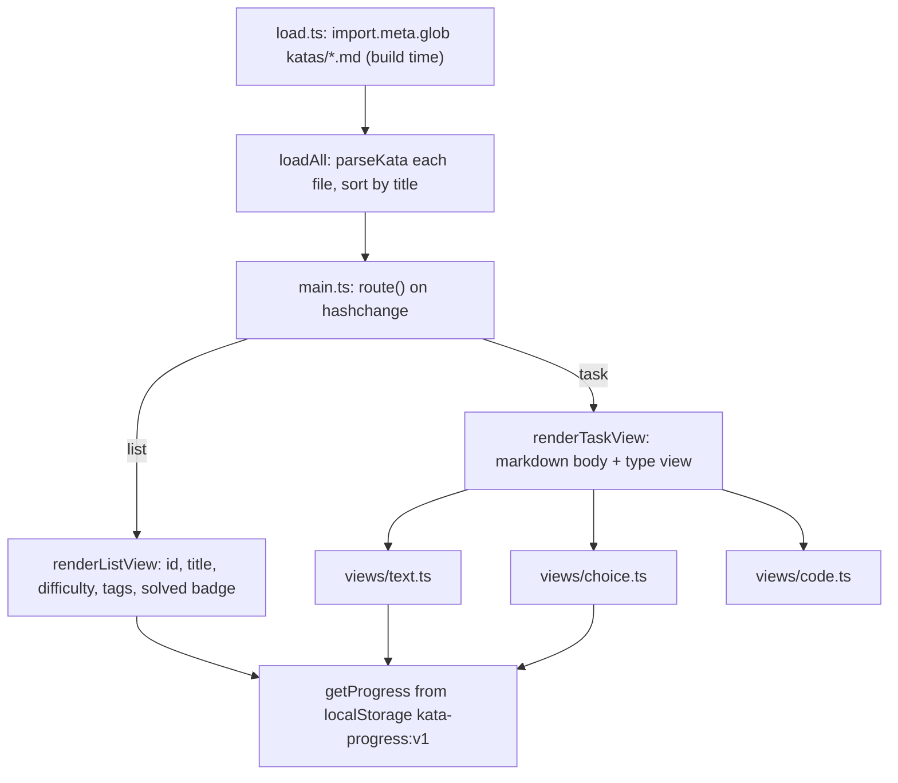

# Architecture Overview

This page is the system map for the kata site: the static-site architecture,
what each component owns, and the two data flows that matter most —
**kata discovery → render** and **code-task submission → grade**. Read it before
diving into a specific subsystem. The authoritative long-form source docs are
[`docs/ARCHITECTURE.md`](../../docs/ARCHITECTURE.md) (component narrative,
sandbox/harness, timeouts, engine decision) and
[`docs/CONTRACT.md`](../../docs/CONTRACT.md) (exact type shapes, file layout,
and the per-component build contract). This page is an orientation layer over
them, not a replacement.

## What this system is

A **static Java code-kata site** for GitHub Pages. There is no backend and no
server-side execution: kata discovery, rendering, answer checking, and Java
compilation/execution all run in the visitor's browser. It is a Vite + vanilla
TypeScript app with hash-based routing, deployed as a static build.

The single most important architectural consequence: everything that would
normally be a server responsibility — file discovery, grading, JVM execution,
sandboxing — is moved to the client or made impossible by the static-site
constraint. The invariants below are all consequences of that fact.

## Key invariants

- **Build-time kata discovery, no runtime FS scan.** Kata files live in
  `katas/*.md` and are enumerated with Vite's `import.meta.glob` (eager, raw)
  at *build* time. There is no manifest to maintain and no runtime directory
  scan; a new kata requires a rebuild (a push to `main` triggers the GitHub
  Actions deploy).
- **Single run at a time.** The runner keeps one `active` request; a second
  `runJava` call while one is in progress is refused with
  `a run is already in progress` rather than queued.
- **Iframe always torn down and rebuilt per run; no CheerpJ session reuse.**
  After every run (ok, error, timeout, or Stop) the sandbox iframe is removed
  and a fresh one is created lazily on the next run. This avoids a stale
  `Main`/`KataRunner` class being served from a previous run under the same
  class names.
- **localStorage-only progress.** Per-kata progress (`solved`, `attempts`,
  `hintsRevealed`) is pure client-side state under `kata-progress:v1`. There
  is no server and no cross-device sync.
- **No server, no server-side execution.** Everything runs in the visitor's
  browser; the only network dependency for code tasks is the CheerpJ runtime
  fetched from the Leaning Technologies CDN.

## Components

| Component | File(s) | Responsibility |
|---|---|---|
| Router + shell | `src/main.ts` | Hash routing (`#/` list, `#/kata/<id>` task view), wires the per-type views |
| Kata loader | `src/kata/load.ts` | Build-time `import.meta.glob` discovery of `katas/*.md`, keyed by path |
| Kata parser | `src/kata/parse.ts` | Frontmatter (js-yaml) + body + `java template` block extraction, per-type validation/defaults |
| Shared types | `src/kata/types.ts` | `Kata` union (`TextKata \| ChoiceKata \| CodeKata`), `Check`, `JavaValue`, etc. |
| Text/stdout matching | `src/check/normalize.ts` | Normalization + comparison for text answers and stdout |
| Import validator | `src/check/imports.ts` | Static whitelist / FQN / ban-list check on submitted source |
| Locked regions | `src/editor/regions.ts` | Template segmentation into editable/locked segments; `validateLocked` re-validation |
| Editor | `src/editor/editor.ts` | CodeMirror 6 editor enforcing locked ranges live |
| Views | `src/ui/views/*.ts` | Per-type task UI (text, choice, code), hints, progress |
| Runner API | `src/runner/runner.ts` | Main-thread `runJava`/`stop`; owns iframe lifecycle, budgets, single-run guard |
| Runner protocol | `src/runner/protocol.ts` | `postMessage` message types between main thread and sandbox |
| Harness codegen | `src/runner/harness.ts` | Generates `KataRunner.java` from a kata's `Check[]` (per run) |
| Verdict | `src/check/verify.ts` | Compares `RunResult` against `Check[]`, builds diff data |
| Sandbox relay | `public/sandbox.html`, `public/sandbox.js` | Thin relay iframe; owns the run timeout and hard-kills the Worker |
| Sandbox worker | `public/sandbox-worker.js` | Dedicated Worker; all CheerpJ compile/run happens here |

Full per-component detail lives in [`docs/ARCHITECTURE.md`](../../docs/ARCHITECTURE.md);
exact type shapes and the agent build contract in
[`docs/CONTRACT.md`](../../docs/CONTRACT.md).

## Data flow: kata discovery → render


*High-level component and data-flow for kata discovery and the render path (list and task views).*

Pipeline for a single kata, list view to render:

1. `load.ts` returns the raw text of every matched `katas/*.md` file, keyed by
   path (build time — there is no runtime scan).
2. `parse.ts` splits YAML frontmatter from the Markdown body, validates and
   defaults fields per `type`, and — for `code` katas — extracts the fenced
   `` ```java template ```` block out of the body (it is removed from the
   rendered description) into `CodeKata.template`.
3. The result is a typed `Kata` consumed by `main.ts`'s router and the per-type
   view in `src/ui/views/`.
4. The list view renders id, title, difficulty, tags, and a solved badge read
   from `localStorage`.
5. The task view renders the Markdown body (`ui/markdown.ts`), hints (revealed
   incrementally and persisted), and the type-specific interaction (text input,
   choice list, or code editor).

## Data flow: code-task submission → grade

This is the most involved path in the system. For a full sequence diagram, see
the one already authored in
[`docs/ARCHITECTURE.md`](../../docs/ARCHITECTURE.md); the end-to-end narrative,
phases, and failure semantics are described in
[/openwiki/workflows/code-execution.md](../workflows/code-execution.md), and the
harness codegen that makes it possible in
[/openwiki/concepts/harness-codegen.md](../concepts/harness-codegen.md). The
safety model behind the static checks and sandbox is in
[/openwiki/concepts/safety-model.md](../concepts/safety-model.md).

At a glance, for one Run:

```
editor (locked regions enforced live)
  -> reassemble full source from editable + locked segments
  -> re-validate locked segments verbatim      (regions.ts)
  -> static import/FQN/ban-list validation     (imports.ts)
  -> if clean: postMessage to sandboxed iframe (runner.ts)
  -> iframe spawns a dedicated Worker and forwards the run request (sandbox.js)
  -> worker: load CheerpJ, write source to virtual FS, compile with javac,
     run a generated KataRunner harness                          (sandbox-worker.js)
  -> harness captures stdout + per-case return values between sentinel markers
  -> worker posts RunResult up; iframe relays to main thread
  -> verify.ts compares RunResult against the kata's Check[]
  -> result/diff UI renders pass/fail per check
```

Two design points shape this flow and are worth holding in mind before reading
any single subsystem:

- **Client-side locked-region enforcement is a UX convenience, not a security
  boundary.** Before every run the full reassembled source is re-validated:
  `validateLocked` checks that the original locked segments still appear
  verbatim, in order, and non-overlapping. This defends against out-of-band
  tampering (e.g. driving CodeMirror via devtools); a run is refused if it
  fails, exactly as if the static import check had failed.
- **CheerpJ runs in a dedicated Worker, not on the iframe's main thread.** A
  tight infinite loop in learner Java (e.g. `while(true){}`) would freeze the
  iframe thread and prevent the very timeout/teardown that has to notice it.
  Moving CheerpJ into a Worker keeps the iframe's thread responsive so its
  timer fires and `worker.terminate()` can hard-kill the runaway code from
  outside regardless of what it is doing; the parent's iframe-removal timer
  remains as a backstop.

### Phases, budgets, and teardown

- **Init/compile budget: 90s.** The first CheerpJ load in a session fetches
  and warms a JVM-in-WASM runtime from the CDN; the UI surfaces this as a
  "Loading Java runtime…" phase so it is not mistaken for a hang.
- **Run budget: the kata's `timeoutMs`** (default 5000), armed only after the
  sandbox reports it has started running the harness.
- **On timeout or Stop**, `sandbox.js` calls `worker.terminate()` (a hard
  kill — there is no cooperative cancellation inside the JVM-in-WASM) and the
  pending run resolves `{ status: 'stopped' }` or `{ status: 'timeout' }`. The
  main thread (`runner.ts`) then tears down and removes the iframe regardless,
  both to force a clean CheerpJ session for the next run and as a backstop
  kill. A fresh iframe is created lazily on the next run.
- **Memory is not portably capped** in-browser; the timeout + Worker
  termination + iframe teardown is the backstop (documented as a known
  limitation).

## Cross-cutting dependencies and load cost

Two distinct third-party artifacts are involved in code-task execution, with
different licenses and different distribution shapes — do not conflate them:

| Artifact | What it is | License | How it ships |
|---|---|---|---|
| CheerpJ runtime | Proprietary WebAssembly JVM (Leaning Technologies) | CheerpJ Community License (free tier) | Loaded **live from the CDN** at runtime; not in the repo or the build |
| `public/tools.jar` | OpenJDK 8 `tools.jar` (~18 MB), the in-browser `javac` compiler | GPLv2 + Classpath Exception | Shipped **as a static asset** in `public/`, copied into `dist/` by Vite |

These shape two cross-cutting constraints that any change to the runner or
sandbox must respect:

- **CheerpJ is a live CDN dependency, never vendored.** `sandbox-worker.js`
  pulls the loader in with `importScripts('https://cjrtnc.leaningtech.com/4.3/loader.js')`;
  the actual JVM-in-WASM runtime is fetched lazily from that CDN only on the
  first code-task run in a session and is then browser-cached. Code tasks
  therefore require network access to `cjrtnc.leaningtech.com` (text/choice
  katas have no such dependency). The loader is pinned to a specific version
  but is **not** hash-verified: `importScripts` inside a Worker supports no
  `integrity` attribute the way a `<script>` tag would, so the dependency is
  trusted at the URL/version level. Do not vendor, bundle, mirror, or
  self-host the CheerpJ runtime — the Community License forbids it; keep the
  live CDN load. (Full license constraints: see
  [/openwiki/operations/deployment.md](../operations/deployment.md).)
- **`tools.jar` is a one-time ~18 MB first-load cost.** In-browser `javac`
  needs a JDK 8 `tools.jar` on its classpath; `sandbox-worker.js` compiles
  against the classpath `/app/tools.jar:/files/` by invoking
  `com.sun.tools.javac.Main` through CheerpJ. That ~18 MB jar is served as a
  static asset from `public/` (a one-time, browser-cached download), which is
  what makes the per-run compile budget feasible after the first load. It is
  a separate file under a separate (GPL-compatible) license from the CheerpJ
  runtime — bundling it is not self-hosting CheerpJ and does not touch the
  Community License restriction.

## Where to go next

- [/openwiki/quickstart.md](../quickstart.md) — running and adding katas.
- [/openwiki/workflows/kata-lifecycle.md](../workflows/kata-lifecycle.md) — a
  kata file from authoring to rendered task.
- [/openwiki/workflows/code-execution.md](../workflows/code-execution.md) —
  full code-task submission→grade flow.
- [/openwiki/concepts/harness-codegen.md](../concepts/harness-codegen.md) —
  how `KataRunner.java` is generated per run.
- [/openwiki/concepts/safety-model.md](../concepts/safety-model.md) — static
  checks + sandbox + teardown as defense in depth.