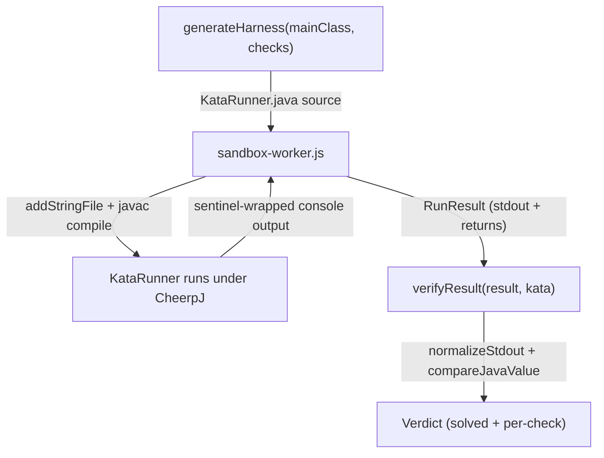
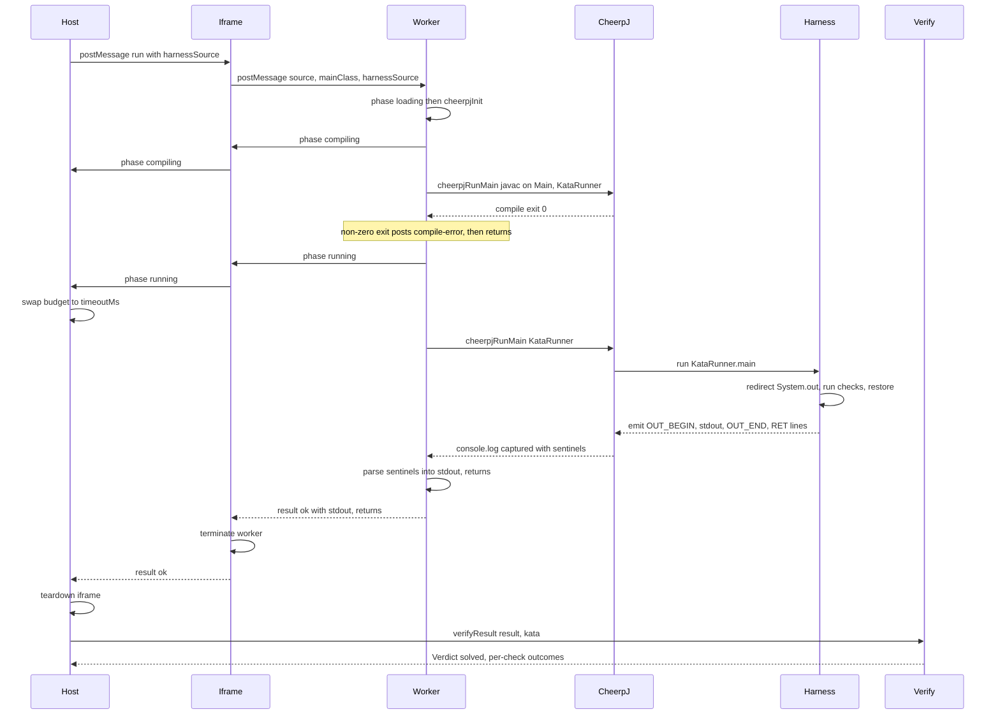

# Harness Codegen and Verdict Comparison

A code kata (`type: 'code'`) is graded by executing the user's Java in the
browser and comparing what it produced against the kata's `Check[]`. Three
modules collaborate across a compile/run/verify pipeline:

- **`src/runner/harness.ts`** — `generateHarness(mainClass, checks)` emits the
  full source of `KataRunner.java` *per run* from the kata's checks. The
  TypeScript side never reflects on the checked method's return type; it only
  turns `JavaValue` arguments into Java literals and lets **Java overload
  resolution** pick the right `toJson(...)` overload at compile time.
- **`public/sandbox-worker.js`** — the CheerpJ Worker compiles
  `<mainClass>.java` + `KataRunner.java` with `javac`, runs `KataRunner`, and
  parses the sentinel-wrapped console output back into a `RunResult`.
- **`src/check/verify.ts`** — `verifyResult(result, kata)` turns a completed
  `RunResult` into a `Verdict`, comparing stdout and return values with the
  same `{type,value}` wrapper shape used by both the kata YAML and the harness.



*Per-run codegen → compile → capture → parse → verify. The harness is regenerated
for every run from `Check[]`; the Worker owns capture and parse; verify owns the
expected-vs-actual comparison.*

The same pipeline as a message sequence across the host page, the sandbox iframe,
its Worker, the in-Worker CheerpJ runtime, the generated `KataRunner`, and
`verifyResult`:



*The iframe forwards phase messages from the Worker to the Host so the Host can
shift its timeout from the 90 s init/compile budget to the kata's `timeoutMs`
once running starts; on any result the iframe terminates the Worker and the Host
tears down the iframe, so each run starts from a fresh CheerpJ session.*

## The JavaValue model

Everything argument-side and expected-side is a `JavaValue`
(`src/kata/types.ts`). The type is a discriminated union:

```ts
export type JavaValue =
  | number | boolean | string | null
  | JavaValue[]
  | { type: 'long' | 'float' | 'char' | 'double' | 'int'; value: number | string };
```

The bare forms (`number`, `boolean`, `string`, `null`, array) are the "plain"
cases. The object form is a **type wrapper** carrying the precise primitive kind
for values that would otherwise lose information in JSON/JS:

- `long` — values beyond `2^53` must be carried as a string so they survive
  round-tripping without float truncation.
- `float` / `double` / `char` — distinguish single vs double precision and
  mark a value as a character rather than a string or number.
- `int` — explicit integer tag.

This same wrapper shape is produced by the harness's `toJson(...)` overloads, so
"expected" (from the kata YAML) and "actual" (parsed from the runner's JSON) can
be compared with identical unwrap logic in `verify.ts`.

## Generating KataRunner.java

`generateHarness` builds the harness body by walking the checks in order. For a
`stdout` check it emits `<mainClass>.main(new String[0]);`; for a `return` check
it emits one `rets.add(toJson(<mainClass>.<method>(<args>)));` line per case, in
order. The emitted calls appear in source in the same order as `checks/cases`,
which is what makes the positional `RunResult.returns` mapping work.

### Reliance on overload resolution

The design's central trick is that **the TS codegen is type-agnostic about the
target method's return type**. `KataRunner` declares one `toJson(...)` overload
per primitive and array type:

```java
static String toJson(int v) { return Integer.toString(v); }
static String toJson(long v) { return "{\"type\":\"long\",\"value\":\"" + v + "\"}"; }
static String toJson(double v) { return Double.toString(v); }
static String toJson(float v) { return Float.toString(v); }
static String toJson(boolean v) { return Boolean.toString(v); }
static String toJson(char v) { return "\"" + jsonEscape(String.valueOf(v)) + "\""; }
static String toJson(String v) { return v == null ? "null" : "\"" + jsonEscape(v) + "\""; }
static String toJson(Object v) { return v == null ? "null" : String.valueOf(v); }
// ... plus one array overload per type: int[], long[], double[], float[], boolean[], char[], String[]
```

`javac` selects the matching overload for whatever `<mainClass>.<method>(...)`
statically returns, so the TS side only needs to render arguments as Java
literals. A `long` return becomes a `{"type":"long","value":"..."}` string; a
`double` becomes a bare `Double.toString(...)`; a `String`/`char` becomes a
JSON-quoted string; an `int` becomes a bare number. The fallback `toJson(Object)`
handles `null` and any object return.

### JavaValue → literal codegen

Argument rendering uses several helpers in `harness.ts`:

- **`scalarLiteral(v)`** — literal for a non-array `JavaValue`:
  - `null` → `null`
  - `boolean` → `true`/`false`
  - `string` → a Java string literal via `javaStringLiteral` (uses
    `escapeJavaChars`, escaping `\`, `"`, `\n`, `\r`, `\t`, and any char
    outside `0x20–0x7e` as `\uXXXX`).
  - `number` → `String(v)` (a bare JS number stays a bare Java int/double
    literal; overload resolution again decides the target type).
  - `long` wrapper → `String(val) + 'L'` (the `L` suffix).
  - `float` wrapper → `String(val) + 'f'`.
  - `int` wrapper → `String(val)`.
  - `char` wrapper → `charJavaLiteral` (handles `'`, `\`, `\n`, `\r`, `\t`,
    printable ASCII in `0x20–0x7e`, else `\uXXXX`).
  - `double` wrapper → `String(val)`, appending `.0` when the textual form
    lacks a `.`, `e`, or `E` so it parses as a `double` not an `int`.

- **`arrayLiteral(arr, hint?)`** — renders a 1-D array literal
  `new <type>[]{...}`. **Only 1-D arrays are supported**; nested arrays throw.
  The element type is inferred from the **first non-null element** via
  `elementJavaType`. An empty array carries no element to infer from, so
  `arrayLiteral` falls back to a `hint` and, absent one, **defaults to `int[]`**.
  `elementJavaType` maps bare JS `boolean`→`boolean`, `string`→`String`,
  `number`→`int`, and the wrapper `{type}` accordingly; it throws on `null`
  (cannot infer from null) and on nested arrays.

- **`literalForArg(v, siblings)`** — the entry point per argument. For a scalar
  it delegates to `scalarLiteral`. For a non-empty array it calls
  `arrayLiteral(v)`. For an **empty array** it scans the *sibling* cases of the
  same argument position: if another case has a non-empty array for that
  argument, it infers the element type from that sibling's first non-null
  element and passes it as the `hint`. With no usable sibling it defaults to
  `int[]`. This is the "empty-array type inferred from sibling cases" rule.

This keeps codegen cheap and correct without any return-type reflection: the
args are fully typed literals, and overload resolution does the rest.

## The sentinel capture protocol

`KataRunner.main` does all its work under a redirected `System.out`. It saves
the real `System.out`, swaps in a `ByteArrayOutputStream`-backed `PrintStream`
(UTF-8), runs the check body, and in a `finally` restores the real stream. Then
it writes results to the *real* stream using four sentinels (defined in
`harness.ts` and mirrored verbatim in the worker):

| Sentinel | Constant | Meaning |
|---|---|---|
| `___KATA_OUT_BEGIN___` | `OUT_BEGIN` | Starts the captured stdout block. |
| `___KATA_OUT_END___` | `OUT_END` | Ends the captured stdout block. |
| `___KATA_RET___` | `RET_PREFIX` | Prefixes each line carrying one return JSON. |
| `___KATA_ERR___` | `ERR_PREFIX` | Prefixes a runtime-error line. |

Emission order on the real stream:

1. `OUT_BEGIN`, then `buf.toString("UTF-8")`, a newline, then `OUT_END` — the
   captured stdout (everything the program printed to `System.out` during the
   redirected body, i.e. around `Main.main` for stdout checks or the method
   calls for return checks).
2. One `RET_PREFIX` + return-JSON line per accumulated `rets` entry, i.e. one
   per return-check case, in the order the cases were emitted.
3. If a `Throwable` was caught, one `ERR_PREFIX` line carrying
   `t.toString() + " at " + st[0]` — only the **first stack-trace element** of
   the caught throwable, not the full trace.

Because the body runs inside one `try`/`catch (Throwable t)`, a thrown
exception during any check suppresses all subsequent checks (control jumps to
`catch`), and the error line is emitted.

## Worker side: capture and parse

`public/sandbox-worker.js` runs CheerpJ in a dedicated `Worker` (not the iframe's
main thread), so a tight infinite loop in the compiled Java can be hard-stopped
with `terminate()` without wedging the timeout owner. There is **no DOM in the
Worker**, so CheerpJ's stdout/stderr land on the worker's own `console.log`/
`console.error`. The worker **monkey-patches** `console.log/error/warn/info` to
append each call's stringified args (joined with spaces) plus a trailing `\n`
into a module-level `captured` buffer, then forwards to the original.

Flow per `onmessage`:

1. **loading** — `ensureInit()` lazily runs `cheerpjInit({ status: 'none' })`
   once.
2. **compiling** — resets `captured`, registers `<mainClass>.java` and
   `KataRunner.java` as in-memory string files via `addStringFile` (a thin
   wrapper over `cheerpOSAddStringFile`/`cheerpjAddStringFile`), and runs
   `com.sun.tools.javac.Main` with classpath `/app/tools.jar:/files/`. A non-zero
   compile exit reports `{ status: 'compile-error', message: captured.trim() || 'Compilation failed.' }`.
3. **running** — resets `captured` again, runs `KataRunner` via
   `cheerpjRunMain('KataRunner', CLASSPATH)`, then parses the captured console
   text.

Parsing rules (only sentinel positions are reliable):

- **Error first.** If `ERR_PREFIX` appears, the run is reported as
  `{ status: 'runtime-error', message: <first line after ERR_PREFIX> }`.
- **Stdout block.** If both `OUT_BEGIN` and `OUT_END` are found, stdout is the
  slice between them with **all leading and trailing blank lines stripped**
  (`.replace(/^\n+/, '').replace(/\n+$/, '')`). This is deliberate: CheerpJ's
  console bridge can flush `print()` vs `println()` into a different number of
  underlying writes than the Java calls made, so the exact newline count around
  the captured block is not reliable — only the sentinel positions are.
- **Returns.** Every line matching `RET_PREFIX` + a payload (regex
  `___KATA_RET___(.*)` globally) contributes `{ json: <payload> }` to
  `returns`, preserving order.
- **Exit-code fallback.** If `runExit !== 0` and there was no `OUT_BEGIN`
  block, report `runtime-error` with the trimmed output (or
  `'Program exited with code ' + runExit`).
- **Otherwise** post `{ status: 'ok', stdout, returns }`.

The worker also posts `phase` messages (`loading`/`compiling`/`running`) so the
runner (`src/runner/runner.ts`) can swap its timeout budget from the
`INIT_BUDGET_MS` (90 s, covering CheerpJ load + compile) to the run-specific
`timeoutMs` once the sandbox reports it has started running.

## Verdict comparison

`verifyResult(result, kata)` produces a `Verdict`:

```ts
interface Verdict {
  solved: boolean;
  checks: CheckOutcome[];
  failure?: { status: string; message?: string };
}
```

### Non-'ok' statuses

If `result.status !== 'ok'`, the verdict is `{ solved: false, checks: [] }` plus
a `failure` carrying the status and, when present, the message. `timeout` and
`stopped` carry no message (`message: undefined`). No per-check data is
produced for non-ok runs — there is nothing to compare.

### stdout checks

Both `expected` (from the check) and `actual` (from `result.stdout`) are run
through `normalizeStdout` (`src/check/normalize.ts`) before string equality:

```ts
export function normalizeStdout(s: string): string {
  return s
    .replace(/\r\n/g, '\n')
    .split('\n')
    .map((line) => line.replace(/[ \t]+$/, ''))
    .join('\n')
    .replace(/\n+$/, '');
}
```

It normalizes `\r\n`→`\n`, strips trailing per-line whitespace (`[ \t]+$`),
and strips trailing newlines. This makes CRLF output, missing trailing
newlines, trailing blank lines, and trailing spaces all compare equal — exactly
the tolerance the worker's unreliable newline counting requires. Internal blank
lines are preserved.

### Return checks (positional)

Return cases are **positional**: `verifyResult` keeps a single `returnIdx`
counter that increments across checks *in order*. For each `return` check, it
maps over `check.cases`, taking `result.returns[returnIdx++]` per case,
`JSON.parse`-ing its `json` (via `parseActual`, which returns `undefined` on a
parse failure or a missing entry), and compares with `compareJavaValue`. A
missing/undefined return makes the case fail. The check passes only if every
case passes; the whole verdict is solved only if every check passes.

### compareJavaValue and type-wrapper unwrapping

`compareJavaValue(actual, expected)` recurses and unwraps the `{type,value}`
wrapper on the expected side (`unwrapExpected`):

- **`null`** — actual must be `null`.
- **array expected** — actual must be an array of equal length, every element
  compared recursively.
- **`long`** — compared as a **string** to avoid `2^53` precision loss. If the
  actual is itself `{type:'long',value}` (the `isLongTagged` shape the harness
  emits), it unwraps `actual.value`; otherwise it `String(actual)`s it, then
  string-compares against `String(value)`.
- **`float` / `double`** — compared with epsilon `EPS = 1e-9`:
  `Math.abs(a - Number(value)) <= EPS`, with the actual coerced via `Number()`
  and required to be finite.
- **`char`** — compared by **codepoint**: the actual's first codepoint (string
  or number) against the expected's codepoint (string or number).
- **`int`** — `Number(actual) === Number(value)`.
- **plain (bare number/string/boolean)** — a bare non-integer `number` expected
  is treated as a double/float and compared with `EPS`; a bare integer is
  compared by `Number` equality; strings/booleans by `===`.

The double dispatch is deliberate: the harness's `toJson(long)` and `toJson(double)`
produce different textual shapes (wrapped vs bare), and the long-as-string rule
lets values like `9007199254740994` compare correctly even though they exceed
JS safe-integer range.

## Extension points and constraints

- **Adding a new primitive return type** means adding a `toJson(<type>)` (and
  `toJson(<type>[])`) overload to the generated `KataRunner` plus a matching
  case in `compareJavaValue`. The overload-resolution design means no TS return-
  type plumbing changes.
- **Nested arrays are unsupported.** `elementJavaType` throws on
  `Array.isArray(v)` and `scalarLiteral` throws on an array; only 1-D arrays
  are emitted.
- **Empty-array typing** relies on sibling cases; an argument that is empty in
  every case defaults to `int[]`. A method expecting, say, `String[]` for an
  always-empty argument would need a non-empty sibling or would be mis-typed.
- **Sentinels are load-bearing across two files.** `harness.ts` defines and
  emits them; `sandbox-worker.js` re-declares the same constants verbatim. They
  are not shared through `protocol.ts`, so changing one without the other breaks
  capture/parse.
- **The harness is per-run and the iframe is rebuilt per run** — `runner.ts`
  generates `harnessSource` from the current `checks` on every `runJava`, and
  the iframe is torn down after each run to avoid a stale `KataRunner`/`Main`
  class being served from a previous run under the same class names.