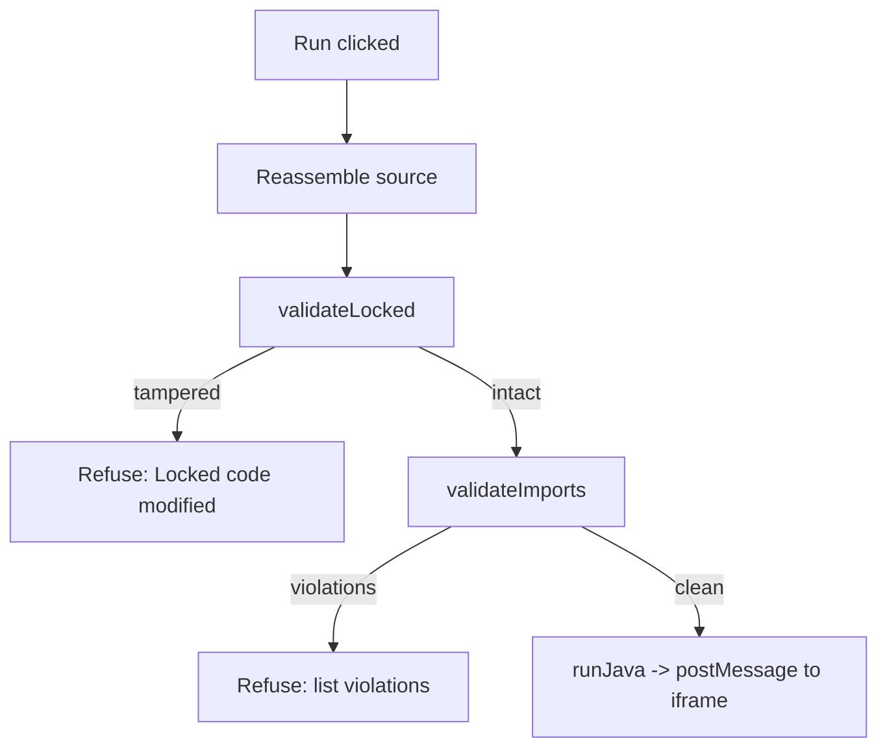
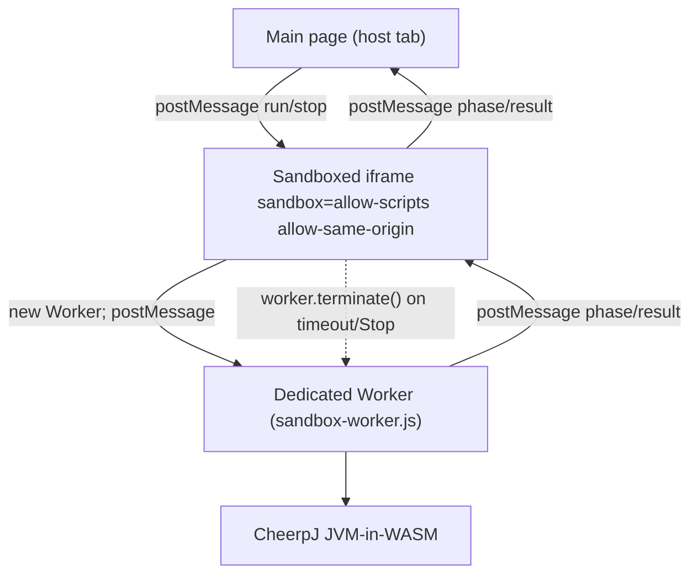
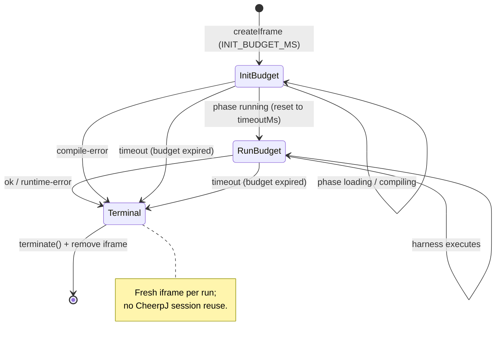

# Safety Model: Imports, Locked Regions, Sandbox

A code kata runs learner-submitted Java in the visitor's own browser via
CheerpJ (a JVM implemented in WebAssembly). There is no server and no
cross-visitor state, so the only thing the "safety" machinery has to protect is
the visitor's own tab from *misbehaving submissions* — infinite loops, runaway
allocations, or misuse of browser-reachable APIs. It is explicitly **defense in
depth, not a security boundary against a determined local attacker**: the code
runs in the visitor's own browser under their own OS user, so there is nothing
to protect them *from* except ill-behaved kata submissions, and no other user's
data is at risk because there is no shared state to attack.

This page documents the four layers that compose that defense-in-depth chain and
the invariants that hold across them:

1. **Static import/FQN/ban-list validation** (`src/check/imports.ts`) — the
   first line of defense; refuses the run *before* any network or iframe
   activity, stopping most misuse before compilation.
2. **Locked-region re-validation** (`src/editor/regions.ts`) — defends against
   out-of-band tampering with the read-only boilerplate.
3. **The sandbox** — a sandboxed iframe → dedicated Worker → CheerpJ
   JVM-in-WASM isolation stack that keeps runaway code off the host tab's
   threads.
4. **Timeout and teardown** — the only backstop for anything a static check
   cannot prevent (e.g. `while(true){}`) and for resource exhaustion.

## Pre-run gate order

The view in `src/ui/views/code.ts` runs the gates in a strict order on every
Run click. A failure at any gate refuses the run with **no network or iframe
activity** — the source never reaches the sandbox:

1. **Reassemble source** from the CodeMirror editor (editable + locked segments).
2. **`validateLocked(source, segments)`** — locked segments must appear verbatim,
   in order, non-overlapping. On failure the UI shows *"Locked code was modified
   — reset or fix."* and offers a Reset.
3. **`validateImports(source, kata.allowedImports)`** — returns an
   `ImportViolation[]`. If non-empty, the UI lists each violation (line number,
   reason, token), reports an incorrect attempt, and refuses the run.
4. Only if both checks pass does the view call `runJava(...)`, which creates the
   iframe and `postMessage`s the request to the sandbox.


*Figure: the pre-run gate order in `src/ui/views/code.ts`. Any failure refuses
the run before any iframe or network activity.*

## Static import/FQN/ban-list validation

`validateImports` in `src/check/imports.ts` is the first line of defense. It
operates on the reassembled source text only — no execution — and produces an
`ImportViolation[]` sorted by line. Its pipeline is:

**`stripNonCode` (masking).** Before any scanning, comments, string literals,
char literals, and text blocks are replaced with **spaces while preserving
newlines**, so line numbers reported in violations stay correct and a banned
token hidden inside a string literal (e.g. `"ProcessBuilder"` in a string) is
not falsely flagged. `lineOf` then maps a character index back to a 1-based line
number over the masked text.

**Import-statement whitelist + ban check.** Every `import` (including
`static`) is matched by `IMPORT_RE` and checked:
- The *checked target* is derived from the statement: for a static import the
  owning package/class is extracted; for a non-static import the target itself
  is used.
- The target is first tested against `bannedPrefixReason` (package-prefix ban)
  and the `BANNED_PATTERNS` list (identifier/call ban). If it is banned, a
  `kind: 'banned'` violation is recorded.
- Otherwise the target is tested against `isWhitelisted`: `java.lang.*` is
  implicitly allowed *except* `java.lang.reflect`; package wildcards (`pkg.*`)
  match only direct members of that package (a token whose suffix contains
  another `.` is not matched by the wildcard); exact rules must match exactly.
  A non-matching, non-banned import yields `kind: 'import'`.
- Matched import statements are then **blanked out** in the masked text so the
  FQN and banned-pattern scans that follow don't double-report the same token.

**FQN bypass scan.** `FQN_RE` matches fully-qualified names used *without* an
import (e.g. `new java.io.File(...)`), over a set of trigger prefixes
(`java`, `javax`, `jakarta`, `sun`, `jdk`, `com`, `org`, `net`, `io`). A matched
FQN is checked against the ban prefixes first (→ `kind: 'banned'`), then
against the whitelist (a non-whitelisted FQN → `kind: 'fqn'`).

**Hard ban list (wins unconditionally).** A fixed set of dangerous APIs is
banned outright and **cannot be re-enabled by any kata's `allowedImports`
whitelist**:

- Reflection / dynamic loading: `Class.forName`, `java.lang.reflect`,
  `ClassLoader`, `MethodHandles`, `Unsafe`.
- Process/native: `Runtime.getRuntime`, `ProcessBuilder`, `ProcessHandle`,
  `System.exit`, `System.load`.
- Concurrency escape: `new Thread`, `Executors`.
- Whole packages: `java.io`, `java.net`, `java.nio`, `javax.*`, `sun.*`,
  `jdk.*` (enforced via `bannedPrefixReason` against both import targets and
  FQN tokens).

The ban check is applied to import targets, to FQN tokens, and (via
`BANNED_PATTERNS`) to bare identifiers/calls that aren't dotted FQNs, so an
escape attempt that names a banned symbol directly is still caught.

## Locked-region re-validation

Locked regions exist so a kata can ship boilerplate (class declaration, a fixed
`main`, helper scaffolding) the learner cannot delete or break.
`src/editor/regions.ts` parses the ```` ```java template ```` block on
`// BEGIN EDIT` / `// END EDIT` marker lines (stripped from what the learner
sees) into alternating `{ text, editable }` segments, and `src/editor/editor.ts`
enforces this *live* in CodeMirror 6: locked ranges are held in a `StateField`
and remapped through every doc change (boundary insertions push the range edges
outward via `mapPos` bias so the locked text itself never drifts into new
content), and a transaction filter blocks any change overlapping the interior
of a locked range (insertions exactly at a boundary are allowed; they extend
adjacent editable text).

Live editor enforcement is a **UX convenience, not a security boundary** — a
visitor can drive CodeMirror via devtools or the DOM. So before every run,
`validateLocked` re-checks the full reassembled source: every non-editable
segment must appear **verbatim, in order, and non-overlapping** (each found after
the end of the previous). A run that fails this check is refused exactly as if
the static import check had failed, with no iframe activity. This closes the
out-of-band-tampering gap that the live editor filter cannot.

## The sandbox: iframe → Worker → JVM-in-WASM

Only source that passes both pre-run gates is ever sent to the sandbox. The
isolation stack has three nested layers:


*Figure: the nested isolation stack. The iframe is a thin relay; all CheerpJ
work happens in the Worker, which the iframe can hard-kill with `terminate()`.*

**Sandboxed iframe.** `src/runner/runner.ts` creates a hidden iframe whose
`sandbox` attribute is `allow-scripts allow-same-origin`. `allow-same-origin` is
required because CheerpJ needs same-origin access to its own worker/caching
machinery to function — the iframe is loaded from `./sandbox.html`, and
`sandbox.js` is its only script. This attribute means the iframe does **not**
give the contained code a separate origin; combined with the static ban list
(which blocks `java.io`/`java.net`/`java.nio` before compilation), the JVM-in-WASM
has no access to the host filesystem or OS processes, and any network access
from Java is limited to what the browser's own fetch/XHR stack permits from that
origin (no raw sockets). The iframe is a **thin relay**: on a `run` message it
creates the Worker and forwards the request; it owns the run-phase timeout and
the `worker.terminate()` kill.

**Dedicated Worker (the reason the split exists).** All CheerpJ work — loading
the runtime, compiling with `javac`, running the generated harness — happens in
`sandbox-worker.js`, a dedicated Worker, not on the iframe's own thread. This
split exists for a concrete failure mode: a tight/non-yielding infinite loop in
learner Java (e.g. `while(true){}`) runs synchronously with no yield point. When
CheerpJ ran on the iframe's main thread, that loop wedged the whole tab, leaving
nothing for the browser to yield to — even the parent page's own timers stopped
firing, so the planned "tear down the iframe on timeout" kill could not be
relied on to actually run. Moving CheerpJ into a Worker keeps the iframe's
thread responsive (so its `setTimeout` reliably fires and `worker.terminate()`
runs) and lets `worker.terminate()` **hard-kill** the runaway code from outside,
regardless of what it is doing. The parent's iframe-removal timer remains as a
backstop in case the iframe's own terminate call somehow didn't run.

**CheerpJ JVM-in-WASM.** `sandbox-worker.js` pulls in CheerpJ via
`importScripts('https://cjrtnc.leaningtech.com/4.3/loader.js')`, calls
`cheerpjInit`, writes the validated source and the generated `KataRunner.java`
harness into CheerpJ's virtual filesystem, and compiles/runs via
`cheerpjRunMain`. (See the [harness codegen](harness-codegen.md) page for the
JS→Java harness and result parsing; the [code execution workflow](../workflows/code-execution.md)
for the end-to-end run.)

## Timeouts and teardown

Two budgets govern a run, owned cooperatively by `runner.ts` (main thread) and
`sandbox.js` (iframe):

- **Init/compile budget: `INIT_BUDGET_MS = 90_000`** (90s), set in `runner.ts`
  and armed when the iframe is created. The first CheerpJ load per session
  fetches and warms a JVM-in-WASM runtime from the CDN, which is slow; the UI
  shows a "Loading Java runtime…" phase so it is not mistaken for a hang. This
  budget covers the `loading` and `compiling` phases.
- **Run budget: the kata's `timeoutMs`** (default `5000`, parsed with a `> 0`
  guard in `src/kata/parse.ts`), armed only after the sandbox reports the
  `running` phase. Both `runner.ts` and `sandbox.js` reset their budget timer to
  `timeoutMs` at that phase transition, so the per-kata timeout does not start
  counting against the (variable) CheerpJ load+compile time.

**Kill sequence.** On timeout, or when the learner clicks Stop:
- `sandbox.js`'s `finish()` clears its timer, calls `worker.terminate()` (a hard
  kill — there is no cooperative cancellation inside the JVM-in-WASM, but a
  Worker can always be stopped from outside regardless of what it's doing), and
  posts `{ status: 'timeout' }` (or `{ status: 'stopped' }` for Stop).
- `runner.ts`'s `finish()` clears the budget timer, then **always tears down and
  removes the iframe from the DOM** and resolves the run promise. Iframe removal
  happens on every terminal status (`ok`, `error`, `timeout`, `stopped`), not
  just timeouts — see the lifecycle invariant below.

**Fresh iframe per run; no CheerpJ session reuse.** After *every* run the
iframe is removed and a fresh one is created lazily on the next `runJava`. The
runner explicitly does not reuse the CheerpJ session across runs: doing so risks
the JVM's classloader serving a stale `Main`/`KataRunner` class from a previous
run under the same class names. The documented upgrade path is to reuse the
iframe across runs once CheerpJ's per-call class (re)loading is confirmed safe,
in order to skip repeat init cost — until then, teardown is mandatory.


*Figure: a single run's lifecycle and budget transition. The run-phase budget
replaces the init budget only once the sandbox reports `running`.*

## What this does and does NOT protect

Stated plainly (per the README "Known limitations" and ARCHITECTURE.md
"Sandboxing properties"):

- **No true memory guard.** There is no portable way to cap memory used by a
  running submission from browser JS that produces a clean, catchable error.
  The run timeout + `worker.terminate()` + iframe teardown is the **only
  backstop** against a runaway submission — one that allocates aggressively but
  finishes within its timeout will *not* be stopped early.
- **Not a security boundary against a local attacker.** The "sandboxed" iframe +
  Worker running CheerpJ protects against nothing the learner's own browser
  doesn't already protect them from: it is their own machine, under their own OS
  user, executing code they wrote themselves. The static import/FQN/ban-list
  check plus the sandbox plus the timeout exist to stop *runaway or ill-behaved
  submissions* from hanging the tab or misusing browser-reachable APIs.
- **No server, no cross-visitor data.** Progress is pure client-side
  `localStorage`; there is no server and no shared state to attack or protect
  between visitors.

The static check is the first line of defense (stops most misuse before
compilation); the sandbox and teardown are the backstop for anything the check
cannot catch or for resource exhaustion, which a static check cannot fully
prevent in general (e.g. `while(true){}`).