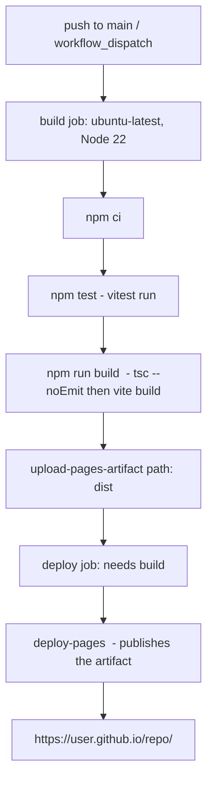

# Build and Deployment

The Code Kata site is a **backend-less static site**: a Vite build produces a
self-contained `dist/` directory that is served verbatim by GitHub Pages. There
is no server-side runtime, no API, and no build-time secret handling. The only
runtime that exists is the CheerpJ WebAssembly JVM that a learner's browser
loads on demand for code katas. Everything below is what an agent must preserve
when touching build or deployment.

## Build pipeline

`npm run build` is defined in `package.json` as the composition
`tsc --noEmit && vite build`:

1. **`tsc --noEmit`** — type-checks the whole `src`/`tests` tree against
   `tsconfig.json` (strict, `target: ES2022`, `moduleResolution: bundler`,
   `noEmit: true`). It emits nothing; it is purely a gate. If it fails the build
   aborts before Vite runs.
2. **`vite build`** — bundles the app into `dist/`. Vite's entry is `index.html`,
   which references `/src/styles.css` and the module script `/src/main.ts`.
   Vite traces the import graph from `main.ts`, tree-shakes, and rewrites the
   absolute `/src/...` references in `index.html` to hashed asset URLs.

`index.html` is the single Vite entry point. Its `<link rel="stylesheet" href="/src/styles.css" />`
and `<script type="module" src="/src/main.ts" />` are the two roots of the
bundle graph; everything else is reached transitively from `main.ts`.

### `base: './'` is load-bearing

`vite.config.ts` contains only `base: './'`:

```ts
export default defineConfig({
  base: './',
});
```

This forces Vite to emit **relative** asset URLs (`./assets/...`) instead of
absolute, root-anchored ones (`/assets/...`). It is required because the site is
deployed as a **GitHub Pages project site**, whose URL is
`https://<user>.github.io/<repo>/` — a sub-path, not the domain root. Absolute
URLs would resolve against the domain root and 404. `base: './'` makes the same
`dist/` work regardless of the repository name or whether the repo is later
moved to a user/org Pages root. Do not change this to `/` or remove it.

### Static assets in `public/`

Vite copies `public/` verbatim into the root of `dist/`. This project ships
three unbundled runtime assets there that are **not** processed by the bundler:

- `public/sandbox.html` + `public/sandbox.js` — the sandbox relay iframe loaded
  by `src/runner/runner.ts` via a relative `src="./sandbox.html"`. These must
  remain plain (un-bundled, un-hashed) files at the deploy root, because the
  runner addresses them by fixed relative path.
- `public/sandbox-worker.js` — the dedicated Worker that actually runs CheerpJ.
  `sandbox.js` constructs it as `new Worker('./sandbox-worker.js')`, again by
  fixed relative path. Because it lives under `public/`, Vite emits it
  untouched; the CheerpJ `importScripts(...)` call inside it survives verbatim.
- `public/tools.jar` — the ~18 MB OpenJDK 8 compiler jar (see
  [tools.jar](#publictoolsjar-and-the-cheerpj-runtime-are-separate-licenses)).

Because these are `public/` assets, none of them are hashed, tree-shaken, or
rewritten by Vite. Their filenames are part of the runtime contract with the
runner and must not be changed without updating the `./sandbox.html` /
`./sandbox-worker.js` references in `runner.ts` and `sandbox.js`.

### Java language level is a build-time content constraint, not a compiler flag

There is no separate Java compilation step in `npm run build` — Java is
compiled **at runtime in the learner's browser** by CheerpJ's in-browser
`javac`. The "Java language level" constraint therefore applies to the **kata
content** (`katas/*.md` templates and reference solutions), not to the build:
target Java 8/11 features and avoid Java 17-only syntax (records, sealed
classes, pattern-matching `switch`). See
[CheerpJ runtime and Java level](#cheerpj-runtime-and-java-level).

## Deployment: GitHub Actions → GitHub Pages

Deployment is the workflow at `.github/workflows/deploy.yml`. It triggers on
every push to `main` and via manual `workflow_dispatch`.



The `build` job runs on `ubuntu-latest` with Node 22 (`actions/setup-node@v4`
with `cache: npm`), then, in order:

1. `npm ci` — clean install from the lockfile.
2. `npm test` — `vitest run` (the unit test gate). A failing test aborts the
   build, so nothing is deployed on red.
3. `npm run build` — the `tsc --noEmit && vite build` pipeline above, producing
   `dist/`.
4. `actions/upload-pages-artifact@v3` with `path: dist` — uploads `dist/` as the
   Pages artifact.

The `deploy` job (`needs: build`) runs `actions/deploy-pages@v4` in the
`github-pages` environment and publishes the artifact. The workflow declares
`permissions: contents: read, pages: write, id-token: write` (the
`id-token: write` is required for the OIDC-based Pages deploy action). A
`concurrency` group named `pages` with `cancel-in-progress: false` serializes
deploys so one push cannot interrupt another mid-publish.

### One-time repo setup

The workflow only works once the repository's Pages source is configured to
**GitHub Actions** (not "Deploy from a branch"):

1. Repo **Settings → Pages → Source: GitHub Actions**.
2. Push to `main`; the workflow builds and deploys automatically.

On a fork or new repo this setting must be re-enabled — the workflow file is
copied by the fork, but the Pages source setting is per-repo and defaults to
"Deploy from a branch".

### Adding a kata is a deploy

Kata files live in `katas/*.md` and are discovered at build time by
`src/kata/load.ts` via Vite's `import.meta.glob` (eager, raw strings). There is
no manifest to edit. Adding a kata is therefore: drop a `.md` file into
`katas/`, push to `main`. The workflow rebuilds, the new glob result is baked
into the bundle, and the kata appears. There is no way to add a kata without a
rebuild — this is a static site, not a CMS.

## CheerpJ runtime and Java level

The CheerpJ runtime is the WebAssembly JVM that lets a learner's browser
compile and run Java for `code` katas. It is **loaded live from Leaning
Technologies' CDN**, never bundled:

- `public/sandbox-worker.js` pulls it in with
  `importScripts('https://cjrtnc.leaningtech.com/4.3/loader.js')` at the top of
  the Worker, then calls `cheerpjInit()` lazily on first use. The loader URL is
  pinned to a specific major version (`4.3`).
- The loader script itself is small; the actual JVM-in-WASM runtime is fetched
  lazily from the CDN **only when a learner first runs a code kata in a
  session**, then browser-cached. This is why the **first code-task run per
  session is slow**: the runner budgets 90 s (`INIT_BUDGET_MS = 90_000` in
  `src/runner/runner.ts`) for the loading + JIT/AOT warm + compile phase, and
  surfaces a `loading` / `compiling` phase to the UI so it is not mistaken for a
  hang. Subsequent runs in the same browser session are fast (cached).
- This CDN dependency means code katas require network access to
  `cjrtnc.leaningtech.com`. **Text and choice katas have no such dependency and
  work fully offline.**

`importScripts` inside a Worker has no `integrity` attribute (unlike a
`<script>` tag), so the CheerpJ loader is trusted at the URL/version level, not
hash-verified via SRI. Pinning the version (`4.3`) is the integrity control.

### Java language level

CheerpJ 4.x has full, production-ready support for **Java 8 and Java 11**, with
partial (also production-supported) Java 17 support. Kata templates and
reference solutions target **Java 8/11 features** to stay inside the
fully-supported range. Avoid Java 17-only syntax (records, sealed classes,
pattern-matching `switch`). This is a content-authoring rule enforced by
convention on `katas/*.md`, not a build flag.

## `public/tools.jar` and the CheerpJ runtime are separate licenses

Two distinct third-party artifacts are involved in code execution, with
**different licenses and different distribution shapes** — do not conflate them:

| Artifact | What it is | License | How it ships |
|---|---|---|---|
| **CheerpJ runtime** | Proprietary WebAssembly JVM (Leaning Technologies) | CheerpJ Community License (free tier) | Loaded **live from CDN** at runtime; **not** in the repo or the build |
| **`public/tools.jar`** | OpenJDK 8 `tools.jar` (~18 MB), the in-browser `javac` compiler | GPLv2 + Classpath Exception | Shipped **as a static asset** in `public/`, copied into `dist/` by Vite |

`sandbox-worker.js` puts `tools.jar` on the compile classpath
(`/app/tools.jar:/files/`) and invokes `com.sun.tools.javac.Main` through
CheerpJ. Bundling `tools.jar` as a separate, aggregated file is **not**
self-hosting CheerpJ — it is a different file, under a different (GPL-compatible)
license. Leaning Technologies' own JavaFiddle ships the same `tools.jar` for the
same reason.

### CheerpJ Community License constraints

The free Community License covers public, non-commercial, open-source projects
that are publicly accessible, and grants unlimited use of CheerpJ loaded from
`cjrtnc.leaningtech.com` — exactly this project's deployment shape (a public
GitHub Pages site). It does **not** permit self-hosting or redistributing the
CheerpJ runtime. Consequences for build/deploy changes:

- **Do not** vendor, bundle, mirror, or self-host the CheerpJ runtime or loader.
  Keep the live `importScripts` CDN load in `sandbox-worker.js`.
- If the project's usage ever becomes **commercial**, or
  **self-hosting/offline** execution is required, a CheerpJ **Commercial
  License** is required instead. (Text/choice katas remain unaffected — they
  never load CheerpJ.)

## GitHub Pages header constraints and forward compatibility

GitHub Pages is purely static hosting and **cannot set custom response headers**
(no `_headers` file, no per-response config). This is currently fine because
**CheerpJ 4.x does not require cross-origin isolation** — it does not need
`Cross-Origin-Opener-Policy` / `Cross-Origin-Embedder-Policy` headers or
`SharedArrayBuffer` to run. Its stated server requirements are HTTPS plus HTTP
**Range request** support (for chunked JAR downloads), both of which GitHub
Pages provides.

This is documented as a forward-compatibility note because it is a real
platform constraint: if a future engine upgrade (a CheerpJ major version, or a
different JVM/engine) ever required cross-origin isolation (e.g. for
`SharedArrayBuffer`/WASM threads), GitHub Pages could not satisfy it directly.
The documented workaround is
[`coi-serviceworker`](https://github.com/gzuidhof/coi-serviceworker) — a
drop-in client-side service worker that intercepts the page's own requests and
**injects the COOP/COEP headers from the client**, making a page functionally
cross-origin-isolated on a host that cannot set headers itself. It is **not
needed today**; it exists as the known escape hatch so a future engine change
does not silently break on Pages.

## Operational invariants for agents changing build/deploy

- Keep `base: './'` in `vite.config.ts`. Absolute paths break project-site
  deployment.
- Keep `public/sandbox.html`, `public/sandbox.js`, and `public/sandbox-worker.js`
  as **un-bundled, un-hashed** files at the deploy root. The runner and relay
  address them by fixed relative path (`./sandbox.html`, `./sandbox-worker.js`).
- Keep the CheerpJ loader as a **live CDN `importScripts`** call pinned to a
  specific version; do not self-host or bundle it (Community License).
- Keep `public/tools.jar` shipped as a static asset (it is the in-browser
  `javac`; separate GPLv2+Classpath-Exception license from CheerpJ).
- Keep the workflow's `npm test` gate before `npm run build` — red tests must
  block deployment.
- Keep the Pages artifact path as `dist`.
- Keep kata content at Java 8/11 language level; do not introduce Java 17-only
  syntax into templates or reference solutions.
- Expect the first code-task run per session to be slow (CDN fetch + warm,
  budgeted 90 s); this is by design, not a bug. Text/choice katas are unaffected.
