# Testing: Unit Tests and Manual Browser Checks

The kata site has two deliberately separated test layers. Only one of them runs
automatically in CI; the other cannot, and that asymmetry is the single most
important fact about this project's test strategy.

1. **Automated unit tests** — `npm test` (`vitest run`), the files in
   `tests/*.test.ts`. These are **pure logic**: no browser, no DOM, no
   CheerpJ, no network. They run on every push to `main` as part of the
   GitHub Pages deploy workflow.
2. **Manual / integration checks** — require a real browser loading the
   live CheerpJ CDN (`cjrtnc.leaningtech.com`) and are run against
   `npm run dev` or a built `dist/` **before a release, and whenever the
   sandbox or runner code changes**.

The split exists because the execution path that actually runs Java —
`public/sandbox.js` + `public/sandbox-worker.js` + the iframe lifecycle in
`src/runner/runner.ts` — depends on CheerpJ's WebAssembly JVM fetched live from
a CDN and on real browser Workers, `postMessage`, and `iframe` semantics.
Headless CI cannot reproduce that path, so it is exercised only by hand. The
long-form matrix of both layers lives in `docs/TESTPLAN.md`.

## CI: where the automated layer runs

The `npm test` step is a hard gate in the Pages deploy pipeline. In
`.github/workflows/deploy.yml` the `build` job runs, in order:

```yaml
- run: npm ci
- run: npm test
- run: npm run build
```

A failing unit test aborts the job before `vite build` produces the artifact,
so a red `npm test` blocks the deploy. Node 22 is pinned
(`actions/setup-node@v4` with `node-version: 22`), and `npm ci` installs from
the lockfile. Because these tests are pure logic, no browser/CDN fixture is
needed and CI stays hermetic. The deploy is therefore the *only* automated
check; nothing else validates changes.

## Unit test suite (`tests/*.test.ts`)

`npm test` resolves to `vitest run` (defined in `package.json`). Vitest is the
sole test framework and sole testing devDependency; the suite has no shared
setup, no fixtures, and no test utilities beyond `describe`/`it`/`expect`.
Each file imports directly from `src/` and asserts on return values or
generated strings. There is intentionally no mocking of the runner, sandbox,
or DOM — those modules are absent from the automated layer entirely.

The table below maps each test file to the module it covers and what it
exercises. It is the authoritative coverage map; `docs/TESTPLAN.md` is the
matching long-form matrix.

| Test file | Module under test | What it covers |
|---|---|---|
| `tests/normalize.test.ts` | `src/check/normalize.ts` | `normalizeText` (trim, collapse whitespace, lowercase); `matchText` across all three modes — `normalized` (case/whitespace-insensitive, `caseSensitive` toggle), `exact` (outer trim only, case sensitivity), `regex` (full-match anchoring `^(?:...)$`, `caseSensitive` maps to the `i` flag); any-of-`answers` matching; `normalizeStdout` — CRLF→LF, trailing whitespace stripped per line, trailing blank lines removed at end-of-output only (mid-output blanks kept). |
| `tests/parse.test.ts` | `src/kata/parse.ts` | `parseKata` for `text`/`choice`/`code`; frontmatter parsed per type; defaults applied (`id` from filename with frontmatter `id` override, `tags: []`, `hints: []`, `match.mode: normalized`, `match.caseSensitive: false`, `multiple: false`, `shuffle: true`, `mainClass: Main`, `timeoutMs: 5000`); `code` kata `java template` fenced block extracted and removed from body; `// BEGIN EDIT`/`// END EDIT` handled; missing required fields (`title`, `answers`, `checks`, template) surface a clear parse error. |
| `tests/imports.test.ts` | `src/check/imports.ts` | Whitelist exact-class and package-wildcard `pkg.*` pass; subpackage boundary (`java.util.*` does not cover `java.util.concurrent.X`); disallowed import rejected (`kind: 'import'`); FQN bypass without an `import` caught (`kind: 'banned'`/FQN); whitelisted FQN usage allowed; `import static` checks the owning class; ban list (`Runtime.getRuntime`, `ProcessBuilder`, `System.exit`, `Class.forName`, `new Thread`) rejected even when whitelisted (`kind: 'banned'`); comment, line/block, string, char, and text-block masking prevents false positives; `java.lang` usable without a whitelist entry; correct line numbers reported. |
| `tests/regions.test.ts` | `src/editor/regions.ts` | `parseTemplate` splits on `// BEGIN EDIT`/`// END EDIT`, strips marker lines, and flags alternating `Segment[]` editable/locked; a marker-less template becomes one fully-editable segment; `initialDoc` reassembles the starter document from segments; `validateLocked` accepts verbatim locked segments in order and rejects deleted, modified, reordered, or overlapping locked segments; a fully-editable template is a no-op (always true). |
| `tests/harness.test.ts` | `src/runner/harness.ts` | `generateHarness` emits `Main.main(new String[0])` for a stdout check and all output sentinels (`OUT_BEGIN`, `OUT_END`, `RET_PREFIX`, `ERR_PREFIX`, `public class KataRunner`); `JavaValue`→Java-literal codegen for every supported type — `int`/`boolean`/`String`, `long` (`L` suffix), `float` (`f` suffix), `char` (char literal), `double` (`.0` suffix when needed), `null`; string escaping (quotes, backslash, newline, unicode); empty-array element type inferred from a sibling case or defaulted to `int[]`; method calls emitted in check/case order (so `RunResult.returns` lines up with `cases`). |
| `tests/verify.test.ts` | `src/check/verify.ts` | `verifyResult` non-ok statuses (`compile-error`, `runtime-error`, `timeout`, `stopped`) carry the failure status/message with no per-check data; stdout checks pass on exact normalized match, tolerate trailing newline/whitespace/CRLF, fail on real mismatch; return checks compare ints exactly, `long`-wrapper values exactly past 2^53, doubles/floats with epsilon (`EPS = 1e-9`), arrays element-wise (length-sensitive), char via `{type,value}` unwrapping; a mixed pass/fail case set is not solved but reports each case individually. |

### What the unit tests deliberately do not touch

The entire CheerpJ execution path is outside this layer's reach. None of these
files import or exercise `public/sandbox.js`, `public/sandbox-worker.js`, or
the iframe/`postMessage` lifecycle in `src/runner/runner.ts`. The runner module
is imported by `tests/verify.test.ts` **only as a type** (`import type {
RunResult }`) so the comparator can be checked without instantiating the
runner. Likewise `src/ui/views/code.ts` (the gate-order wiring, diff UI,
`aria-live` announcements) and `src/ui/progress.ts` (`localStorage`
persistence) have **no automated tests**: they are browser-only and are covered
by the manual layer below.

This is a known, accepted gap, not an oversight. There is **no automated
browser/CDN integration test** of any kind in the repository. Whenever a
change touches `sandbox.js`, `sandbox-worker.js`, or the runner's iframe
lifecycle, treat the relevant manual checks as mandatory review items — the
unit suite cannot catch a regression there.

## Manual / integration checks

These require a real browser loading CheerpJ live from
`cjrtnc.leaningtech.com`, run against `npm run dev` or a built `dist/` (see
Build and Deployment). They are the **only** coverage for the sandbox/runner
path and for browser-only UI behavior, and they must be run before a release
or whenever the runner/sandbox code changes.

| Area | Procedure |
|---|---|
| **Timeout** | Submit an infinite-loop program (e.g. `while(true){}`) against a kata with a short `timeoutMs`. The sandbox iframe's tab must stay responsive throughout (so it can fire its own timer and `terminate()` the Worker); the status ends as `timeout` within roughly `timeoutMs` + teardown overhead, and the UI shows a clear timeout message, not a hang. |
| **Stop button** | Click Run, then Stop before it finishes. Confirm the Worker is terminated and the iframe torn down, the pending promise resolves `{status:'stopped'}`, and the UI returns to an idle/re-runnable state (a subsequent Run works, recreating the iframe). |
| **Compile-error surfacing** | Submit deliberately invalid Java; confirm `status: 'compile-error'` with a usable message is shown to the learner, not a silent failure or a raw stack dump. |
| **Runtime-error surfacing** | Submit code that throws (e.g. an unhandled exception, `ArrayIndexOutOfBoundsException`); confirm `status: 'runtime-error'` is surfaced distinctly from `compile-error` and from a check failure. |
| **Return-value checks** | Exercise `int`, `long` (incl. values > 2^53 via wrapper form), `double`, `float` (wrapper form), `boolean`, `char` (wrapper form), `String`, `null`, and 1-D arrays of each; confirm the per-case pass/fail table is correct. |
| **Stdout diff UI** | Submit output that differs from `expected` by one line; confirm the line-level diff highlights the differing line(s) and normalization (trailing whitespace/newline/CRLF) does not cause false mismatches. |
| **First-run load phase** | Fresh browser session, no CheerpJ cache. Confirm the "Loading Java runtime…" phase is shown during the slow first CDN fetch and does not appear to hang past the documented 90 s init/compile budget under normal network conditions. |
| **Locked-region tamper** | Attempt to edit a locked region via devtools / direct DOM manipulation, then submit. Confirm the pre-run re-validation in `regions.ts` rejects the tampered source with an error and no run is sent to the sandbox. |
| **Import bypass** | Submit a banned API not caught by editor affordances. Confirm rejection happens before any network or iframe activity — the static check runs first and short-circuits. |
| **Progress persistence** | Solve a kata, reveal hints, reload the page. Confirm `kata-progress:v1` in `localStorage` persists `solved`/`attempts`/`hintsRevealed` across reloads. |
| **Accessibility** | Confirm the result is announced via `aria-live="polite"`, all interactive controls are real `<button>`s reachable and operable by keyboard with visible focus. |

Several of these checks exist precisely because the unit suite cannot reach
the code they guard. The timeout and Stop checks validate the Worker-split
design in `public/sandbox.js` / `sandbox-worker.js`: the iframe's main thread
stays responsive so its `setTimeout` can fire and `worker.terminate()` can
run even when the compiled Java is a tight infinite loop that never yields.
The locked-region-tamper and import-bypass checks validate the pre-run gate
order in `src/ui/views/code.ts` (locked-region re-validation, then import
validation, both before any iframe activity) — the same gates whose pure
logic *is* unit-tested in `regions.test.ts` and `imports.test.ts`, but whose
wiring and UI surfacing are only checked here.

## How the two layers relate

The unit and manual layers are complementary, not redundant. Where a pure
function exists in `src/`, it has a unit test: `normalize.ts`,
`parse.ts`, `imports.ts`, `regions.ts`, `harness.ts`, and `verify.ts` are
each exercised directly and exhaustively. The browser-only glue — the runner's
iframe lifecycle, the sandbox's Worker/CheerpJ coordination, the view's gate
ordering and result rendering, and `localStorage` progress — has no unit test
and is instead covered by the manual matrix. The diagram below shows which
runtime path each layer reaches.

```mermaid
flowchart TD
    Unit["Unit tests (Vitest, CI)"]
    Manual["Manual checks (browser + CheerpJ CDN)"]

    Unit --> N["src/check/normalize.ts"]
    Unit --> P["src/kata/parse.ts"]
    Unit --> I["src/check/imports.ts"]
    Unit --> R["src/editor/regions.ts"]
    Unit --> H["src/runner/harness.ts"]
    Unit --> V["src/check/verify.ts (type only)"]

    Manual --> CV["src/ui/views/code.ts (gate order, diff UI, aria-live)"]
    Manual --> PR["src/ui/progress.ts (localStorage)"]
    Manual --> RN["src/runner/runner.ts (iframe lifecycle)"]
    Manual --> SJ["public/sandbox.js (timer + terminate)"]
    Manual --> SW["public/sandbox-worker.js (CheerpJ compile/run)"]

    style Unit fill:#d6f5d6
    style Manual fill:#fde2c4
```



*Unit tests reach the pure-logic modules (green); manual checks reach the
browser/CDN-only execution path and UI wiring (orange). The runner module is
imported by `verify.test.ts` only as a type.*

The consequence for any change is concrete:

- Editing a pure-logic module (`normalize`, `parse`, `imports`, `regions`,
  `harness`, `verify`) — `npm test` is the relevant check, and CI enforces it.
- Editing `sandbox.js`, `sandbox-worker.js`, `runner.ts`, the code view's
  gate/UX wiring, or `progress.ts` — **CI will not catch a regression**. Run the
  relevant manual checks (at minimum timeout, Stop, compile/runtime-error
  surfacing, and the load phase for any sandbox change), and flag the manual
  matrix as a review item in the change description.

The long-form version of every check above — unit and manual, with exact
procedures — is `docs/TESTPLAN.md`; keep that document current when the check
set changes, since it is the reference the release process relies on.
