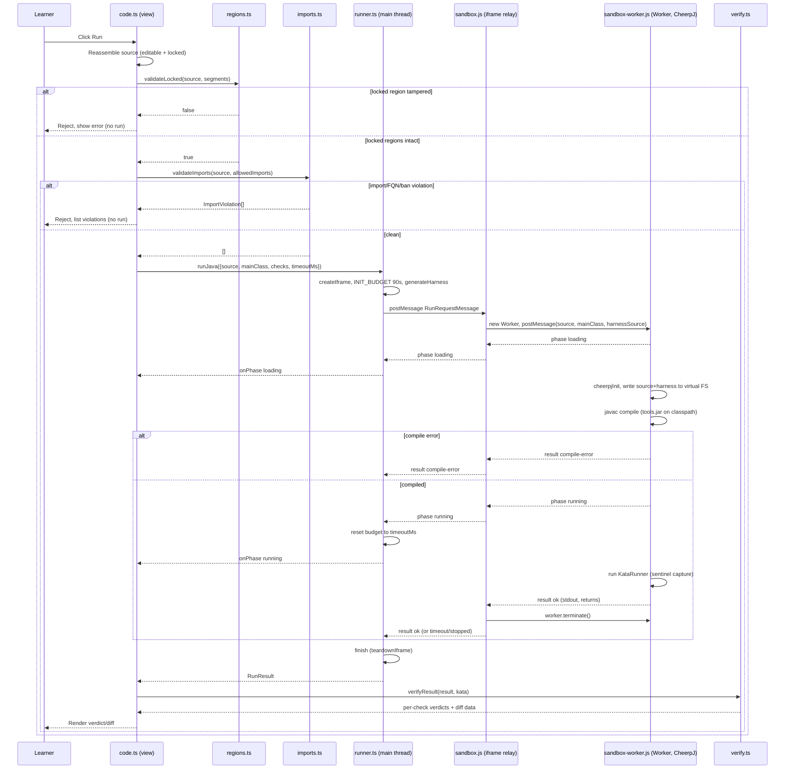

# Workflow: Code-Task Execution Path

This page traces the most involved path in the system: what happens between the
learner clicking **Run** on a code kata and the pass/fail panel appearing in the
UI. It is the page to read before touching
[`src/runner/runner.ts`](../../src/runner/runner.ts),
[`src/runner/protocol.ts`](../../src/runner/protocol.ts),
[`src/ui/views/code.ts`](../../src/ui/views/code.ts),
[`src/check/verify.ts`](../../src/check/verify.ts), or the two sandbox files
[`public/sandbox.js`](../../public/sandbox.js) /
[`public/sandbox-worker.js`](../../public/sandbox-worker.js).

The path crosses four trust zones — main-thread UI, the sandboxed iframe, a
dedicated Worker, and the CheerpJ JVM-in-WASM — connected only by `postMessage`.
Read the gates first ([Safety Model](../concepts/safety-model.md)), then the
harness internals ([Harness Codegen and Verdict Comparison](../concepts/harness-codegen.md)),
then the `Check[]` shape ([Kata Task Format](../concepts/kata-format.md)); this
page stitches them into one run.

## End-to-end sequence

*Figure: one Run from click to verdict, extending the sequence diagram in
`docs/ARCHITECTURE.md` with the phase→budget transition in `runner.ts`.*

## Phase 1 — Pre-run gates (main thread, no execution)

`renderCodeView` in [`src/ui/views/code.ts`](../../src/ui/views/code.ts) owns the
Run button. Its `onRun` handler runs a strict gate order on every click; any
failure refuses the run **before** any iframe or network activity, so a
misbehaving submission never reaches the sandbox:

1. **Reassemble source** — `editor.getSource()` reconstructs the full Java text
   from the CodeMirror editor's editable + locked segments.
2. **`validateLocked(source, segments)`**
   ([`src/editor/regions.ts`](../../src/editor/regions.ts)) — the original locked
   segments must still appear verbatim, in order, and non-overlapping. On
   failure, `showLockedError()` renders *"Locked code was modified — reset or
   fix."* plus a **Reset** button that rebuilds the editor from `kata.template`.
3. **`validateImports(source, kata.allowedImports)`**
   ([`src/check/imports.ts`](../../src/check/imports.ts)) — returns an
   `ImportViolation[]`. If non-empty, `showViolations()` lists each violation
   (`Line N: reason (token)`) and `feedback.report(false)` records an incorrect
   attempt; the run is refused.

Only if both gates pass does the view disable Run, enable Stop, and call
`runJava(...)`. This is the defense-in-depth chain documented in
[Safety Model](../concepts/safety-model.md): the static checks stop most misuse
before compilation, and the sandbox/teardown backstop the rest.

## Phase 2 — Runner: single run, fresh iframe, budget handoff

`runJava` in [`src/runner/runner.ts`](../../src/runner/runner.ts) is the only
entry point to the sandbox. It enforces three invariants:

- **Single run at a time.** A module-level `active` object holds the in-flight
  request. A second `runJava` call while `active` is set returns immediately with
  `{ status: 'error', message: 'a run is already in progress' }` — it is *not*
  queued.
- **Fresh iframe per run, no CheerpJ session reuse.** `runJava` first calls
  `teardownIframe()`, then `createIframe()` builds a hidden
  `<iframe sandbox="allow-scripts allow-same-origin" src="./sandbox.html">`.
  Reusing a session risks the JVM classloader serving a stale `Main`/`KataRunner`
  class from a previous run under the same class names.
- **Phase-driven budgets.** The run is armed with `INIT_BUDGET_MS = 90_000`
  (loading CheerpJ + `javac` compile; the first session fetches and warms a
  JVM-in-WASM runtime from the CDN). When the sandbox reports
  `phase: 'running'`, `handleMessage` clears the init timer and rearms the
  budget to the kata's `timeoutMs` (default 5000). So the slow first-load cost
  is charged to the init budget, and only the actual harness execution is
  charged to the run budget.

On the iframe `load` event, `runJava` builds a `RunRequestMessage` (see the
protocol below) — crucially, `harnessSource: generateHarness(req.mainClass,
req.checks)` is computed here on the main thread, per run — and `postMessage`s
it to the iframe's `contentWindow`.

### The postMessage protocol

[`src/runner/protocol.ts`](../../src/runner/protocol.ts) defines the contract
between the main thread and the sandbox iframe (mirrored in plain JS by
`public/sandbox.js` since the sandbox ships unbundled):

- **`RunRequestMessage`** (`type: 'run'`) — carries `requestId`, `source`,
  `mainClass`, `checks`, `timeoutMs`, and `harnessSource` (the generated
  `KataRunner.java` source, produced by
  [`src/runner/harness.ts`](../../src/runner/harness.ts)).
- **`StopMessage`** (`type: 'stop'`) — carries `requestId`; sent when the
  learner clicks Stop.
- **`PhaseMessage`** (`type: 'phase'`) — the sandbox reports one of
  `Phase = 'loading' | 'compiling' | 'running'`. Only `'running'` triggers the
  budget reset.
- **`ResultMessage`** (`type: 'result'`) — carries the terminal `result`,
  whose `status` is one of:
  - `'ok'` — `stdout: string`, `returns: { json: string }[]`
  - `'compile-error' | 'runtime-error' | 'error'` — `message: string`
  - `'timeout'` — no payload
  - `'stopped'` — no payload

`runner.ts`'s `handleMessage` filters strictly: it ignores any message whose
`event.source` is not the iframe's `contentWindow`, and any message whose
`requestId` does not match `active.requestId` (so a stale message from a torn
down iframe cannot resolve a later run).

### The relay iframe

`public/sandbox.js` is intentionally a thin relay. It owns the run timeout and
the hard kill, but does **no** CheerpJ work on its own thread. On a `run`
message it creates `new Worker('./sandbox-worker.js')` and forwards
`{source, mainClass, harnessSource}` to it. Its own thread must stay responsive
so that, if the learner's Java is a tight `while(true){}` running in the Worker,
the iframe's `setTimeout` still fires and `worker.terminate()` can actually run.
On `phase: 'running'` from the Worker it switches its timer from the implicit
init budget to `msg.timeoutMs`; on any `result` or on `worker.onerror`, its
`finish()` clears the timer, calls `worker.terminate()`, and posts the
`ResultMessage` up to the parent. A `stop` message matching the active
`requestId` resolves `{ status: 'stopped' }` the same way.

## Phase 3 — CheerpJ compile and run inside the Worker

`public/sandbox-worker.js` is where all JVM work happens. It
`importScripts` the pinned CheerpJ loader
(`https://cjrtnc.leaningtech.com/4.3/loader.js`) and, per run:

1. Posts `phase: 'loading'`, then `await cheerpjInit()` (memoized in
   `initPromise` so the slow first load happens once per Worker).
2. Posts `phase: 'compiling'`, writes the user's source and the harness to
   CheerpJ's virtual FS under `/str/` (`cheerpOSAddStringFile`/
   `cheerpjAddStringFile`), and runs the in-browser `javac` via
   `cheerpjRunMain('com.sun.tools.javac.Main', CLASSPATH, srcMain, srcHarness,
   '-d', '/files/')` with `CLASSPATH = '/app/tools.jar:/files/'` (the JDK 8
   `tools.jar` shipped at `public/tools.jar`). A non-zero exit posts
   `{ status: 'compile-error', message: captured.trim() || 'Compilation failed.' }`
   and returns.
3. Posts `phase: 'running'`, resets the captured console buffer, and runs the
   harness via `cheerpjRunMain('KataRunner', CLASSPATH)`.

### Sentinel capture

There is no DOM inside a Worker, so CheerpJ's stdout/stderr surface on the
Worker's own `console.log`/`console.error`. The Worker monkeypatches
`console.log/error/warn/info` for the run to append everything to a `captured`
string. The harness (see [Harness Codegen](../concepts/harness-codegen.md))
wraps its output in sentinel markers defined identically in
[`src/runner/harness.ts`](../../src/runner/harness.ts) and
`public/sandbox-worker.js`:

- `___KATA_OUT_BEGIN___` / `___KATA_OUT_END___` — bracket the captured stdout
  for a `stdout` check (the harness redirects `System.out` to an in-memory
  buffer around `Main.main`, then prints that buffer back out between the
  markers).
- `___KATA_RET___<json>` — one line per `return`-check case; the harness emits
  a `rets.add(toJson(Main.method(args)))` per case and prints each as a
  `RET_PREFIX` line, relying on Java overload resolution (not TS reflection) to
  pick the right `toJson(...)` overload for the method's return type.
- `___KATA_ERR___<message>` — a runtime-error sentinel; if present, the Worker
  reports `{ status: 'runtime-error', message }`.

After the run, the Worker parses `captured`: if `ERR_PREFIX` is present it
reports a runtime error; otherwise it slices the stdout between `OUT_BEGIN` and
`OUT_END` (stripping *all* leading/trailing blank lines, because CheerpJ's
console bridge does not preserve an exact newline count — only the sentinel
positions are reliable), collects every `RET_PREFIX` line into
`returns: { json: string }[]`, and posts
`{ status: 'ok', stdout, returns }`. A non-zero `runExit` with no `OUT_BEGIN`
is treated as a runtime error. Any thrown exception becomes
`{ status: 'error', message }`.

The positional mapping that makes this work: `verifyResult` walks `kata.checks`
in order, incrementing a `returnIdx` for each `return` check, so `returns[i]`
corresponds to the i-th emitted return-case line, which corresponds to the i-th
case in `check.cases` — because `generateHarness` emits the calls in the same
order as `checks/cases`.

## Phase 4 — Verdict and render

Back on the main thread, `runner.ts`'s `finish()` runs regardless of outcome:
it clears the budget timer, nulls `active`, calls `teardownIframe()` (always
removing the iframe — for a clean CheerpJ session next run and as a backstop
kill), and resolves the `runJava` promise with the `RunResult`.

`code.ts`'s `onRun` awaits that promise, clears the phase indicator, and calls
`showResult(container, result, kata)`. The rendering splits by status:

### Failure rendering (`renderFailure`)

For any non-`ok` status, the view shows a single `feedback-incorrect` paragraph
whose text comes from the `FAILURE_LABEL` map in
[`src/ui/views/code.ts`](../../src/ui/views/code.ts):

| status | label |
|---|---|
| `compile-error` | "Compilation failed:" |
| `runtime-error` | "Runtime error:" |
| `timeout` | "Timed out — check for infinite loops or long-running code." |
| `stopped` | "Stopped." |
| `error` | "Something went wrong running your code:" |

`compile-error`, `runtime-error`, and `error` additionally append the message
inside a `<pre class="compiler-output">` (only when `'message' in result` and
the message is non-empty). `timeout` and `stopped` carry no message and show
the label alone. `showResult` returns `undefined` for these so no
solved/attempts feedback is recorded beyond the run itself.

### Success rendering (`verifyResult` + `renderVerdict`)

For `status: 'ok'`, `showResult` calls
`verifyResult(result, kata)` in [`src/check/verify.ts`](../../src/check/verify.ts),
which produces a `Verdict` (`{ solved, checks: CheckOutcome[] }`):

- For a **`stdout` check** it normalizes both `check.expected` and
  `result.stdout` via `normalizeStdout` and compares for equality.
- For a **`return` check** it maps each case to its positional
  `result.returns[returnIdx++]`, `JSON.parse`s the `json`, and compares with
  `compareJavaValue`, which unwraps the `{type, value}` form the same way on
  both expected (kata YAML) and actual (harness JSON) sides — `long` compared as
  string, `float`/`double` with a `1e-9` epsilon, `char` by code point, `int`
  by numeric value, arrays element-wise, and plain values directly. `solved` is
  true only if every check (and every case within each return check) passes.

`renderVerdict` then renders a summary line (`✓ All checks passed!` /
`✗ Some checks failed.`) and, per check:

- **stdout** — a `check-block` with "Output matches" / "Output does not match".
  On failure it builds a two-column **line-level diff** (`diff-panel` with
  Expected/Actual `diff-column`s) where lines that differ between the two sides
  get a `diff-line-mismatch` class.
- **return** — a `check-block` with a **per-case table** (`cases-table`), one
  row per case with columns Args, Expected, Actual, and a pass/fail glyph;
  `formatValue`/`formatArgs` unwrap the `{type,value}` wrapper to a display
  string. Each row is classed `case-pass`/`case-fail`.

Finally, `onRun` calls `feedback.report(verdict.solved)` so the hints controller
records solved/attempts to `localStorage` under `kata-progress:v1`, and its
`finally` block re-enables Run and disables Stop — regardless of whether the
run resolved, errored, or was stopped.

## Invariants and failure semantics at a glance

- **Single run at a time** — `runJava` refuses a second concurrent call with
  `{ status: 'error', message: 'a run is already in progress' }`.
- **Iframe always torn down** — `finish()` calls `teardownIframe()` on every
  outcome (ok, compile-error, runtime-error, error, timeout, stopped); a fresh
  iframe is created lazily on the next `runJava`.
- **Worker always terminated** — `sandbox.js`'s `finish()` calls
  `worker.terminate()` on every result/stop/timeout/error; there is no
  cooperative cancellation inside the JVM-in-WASM, so termination is the only
  hard kill for runaway code.
- **Budget handoff** — the 90s `INIT_BUDGET_MS` covers loading + compiling; the
  kata's `timeoutMs` is armed only when `phase: 'running'` arrives. A timeout
  during init still reports `{ status: 'timeout' }`.
- **Message filtering** — `runner.ts` ignores messages from the wrong
  `event.source` or with a non-matching `requestId`; `sandbox.js` ignores
  anything not from `window.parent`.
- **No memory cap** — runaway allocation is backstopped only by the timeout +
  Worker termination + iframe teardown; there is no portable in-browser memory
  limit (documented as a known limitation).
