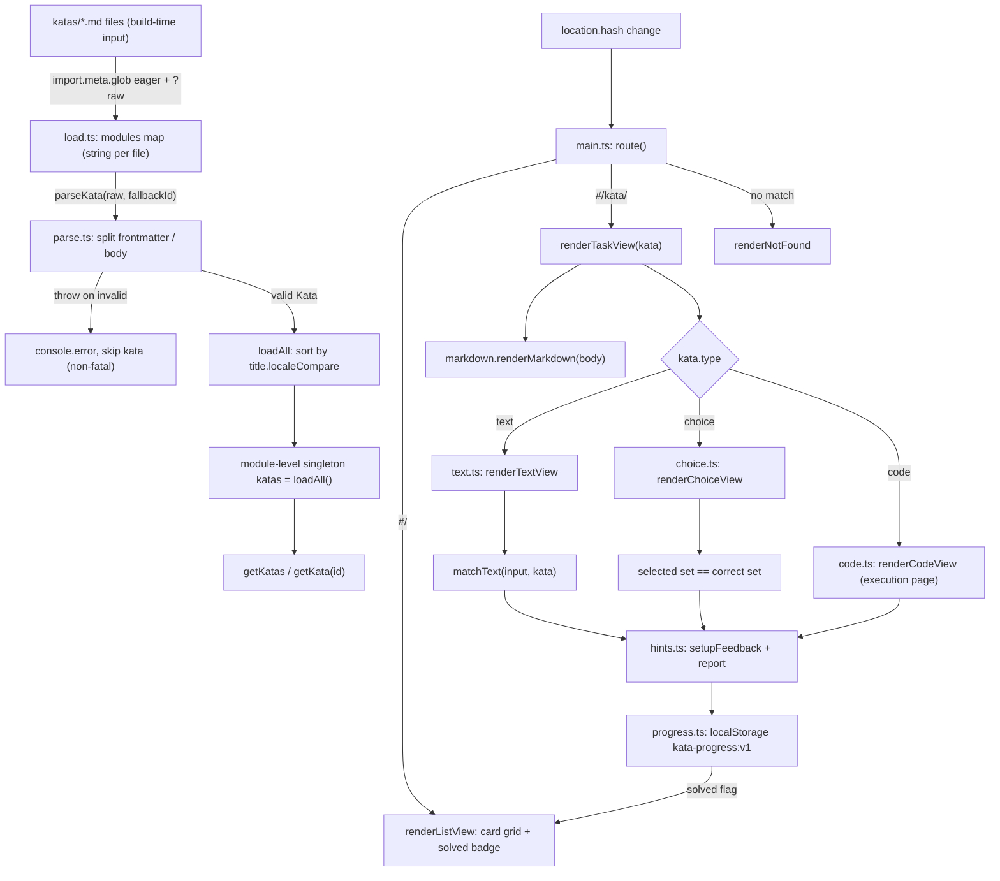

# Workflow: Kata Discovery, Render, and Progress

This page covers the **non-execution lifecycle** of a kata: how a `.md` file in
`katas/` is discovered at build time, parsed and validated, routed to a view,
rendered, graded for the simple task types, and how progress and hints persist in
the browser. It is the page to read before changing
[`src/main.ts`](../../src/main.ts), [`src/kata/load.ts`](../../src/kata/load.ts),
[`src/kata/parse.ts`](../../src/kata/parse.ts),
[`src/ui/views/text.ts`](../../src/ui/views/text.ts) +
[`src/ui/views/choice.ts`](../../src/ui/views/choice.ts),
[`src/ui/hints.ts`](../../src/ui/hints.ts),
[`src/ui/progress.ts`](../../src/ui/progress.ts), or
[`src/ui/markdown.ts`](../../src/ui/markdown.ts).

The **code** kata diverges here: its grading runs the learner's Java in a sandbox
and compares against `Check[]`. That execution path is documented separately in
[Code-Task Execution Path](./code-execution.md), and the frontmatter schema every
type shares is the reference in [Kata Task Format](../concepts/kata-format.md).
This page treats code katas only as far as discovery/parsing/render-dispatch and
the shared feedback/hints/progress wiring; everything after the Run button
belongs to the execution page.

## End-to-end flow



*From a `.md` file on disk to a graded, persisted result. Discovery and parsing
happen once at module load; routing re-renders on every hash change; grading for
text/choice is pure and synchronous, code grading hands off to the runner.*

## Discovery: build-time glob, no manifest

`src/kata/load.ts` is the only discovery point. It uses Vite's
`import.meta.glob('../../katas/*.md', { query: '?raw', import: 'default', eager: true })`
to inline every `katas/*.md` file as a raw string **at build time**. There is no
runtime filesystem scan and no manifest to maintain: adding a kata means dropping
a `.md` file into `katas/` and rebuilding.

Because the glob is `eager`, `loadAll()` runs once at module load, iterates the
`{ path -> raw }` entries, and calls `parseKata(raw, fallbackId)` for each. The
`fallbackId` is the filename without the `.md` extension — used only when the
frontmatter omits an explicit `id`. Parse failures are **non-fatal**: a `try`
around `parseKata` logs `Failed to parse kata "<filename>": <err>` to
`console.error` and the malformed kata is simply skipped, so one bad file cannot
break the whole app. Successfully parsed katas are sorted by
`title.localeCompare` and cached in a module-level singleton; `getKatas()`
returns the sorted list and `getKata(id)` does a linear find by id.

## Parsing and validation

`src/kata/parse.ts` turns one raw string into a `Kata`. The contract is strict:
invalid input throws, and `load.ts` treats any throw as a skip. The shared
`Kata` type and the per-type shapes live in [`src/kata/types.ts`](../../src/kata/types.ts)
(see [Kata Task Format](../concepts/kata-format.md) for the full schema).

`parseKata(raw, fallbackId)` proceeds in fixed order:

1. **Split frontmatter.** `FRONTMATTER_RE` matches a leading `---\n…\n---\n`
   block. No match throws "missing YAML frontmatter". The captured YAML is
   `js-yaml.load`-ed; it must be a mapping object or parsing throws.
2. **Common fields.** `id` = explicit frontmatter `id` or `fallbackId`;
   `title` is required (non-empty string) or the kata throws; `type` must be one
   of `text|choice|code`; `difficulty` must be `easy|medium|hard`. `tags` and
   `hints` are parsed via `parseStringArray`, which accepts an array of strings
   or `undefined` (defaults to `[]`) and throws for any other shape.
3. **Extract the code template.** For code katas, `TEMPLATE_RE` finds a
   ` ```java template ` fenced block in the **body**. When present, the block's
   inner text becomes `CodeKata.template` (trailing newline stripped) and the
   entire fenced block is **removed from `body`** before rendering. The body is
   then trimmed. This is why the rendered code-kata prose never shows the
   starter code.
4. **Dispatch on `type`.** A `base` object
   `{ id, title, difficulty, tags, hints, body }` is built and passed to the
   per-type parser, which validates type-specific fields and applies defaults:
   - **`parseTextKata`** requires a non-empty `answers` string array and a `match`
     mapping whose `mode` defaults to `normalized` (must be
     `normalized|exact|regex`) with `caseSensitive` defaulting to `false`.
   - **`parseChoiceKata`** requires a non-empty `options` array; each option must
     have a string `text` and boolean `correct`, and **at least one option must be
     correct**. `multiple` defaults to `false`; `shuffle` defaults to `true`
     (opt-out with `shuffle: false`).
   - **`parseCodeKata`** requires a non-empty `template` (i.e. the body contained
     a `java template` block) and a non-empty `checks` array of `stdout` or
     `return` checks. Defaults: `mainClass = 'Main'`, `timeoutMs = 5000`,
     `allowedImports = []`. The `checks` structure (`stdout.expected` string vs
     `return.method` + `cases[]`) is the bridge to the execution path.

Every thrown error message is prefixed with the kata `id` (or `fallbackId`), so
the `console.error` in `load.ts` names the offending file.

## Routing: a hash router with no framework

`src/main.ts` owns the single-page navigation. `route()` reads `location.hash`
and matches `^#/kata/(.+)$`; the captured id is `decodeURIComponent`-decoded
before lookup so ids with special characters work. Three outcomes:

- **`#/kata/<id>` found** → `renderTaskView(kata)`.
- **`#/kata/<id>` not found** → `renderNotFound(id)` (a "not found" paragraph).
- **anything else** (including `#/` and empty hash) → `renderListView()`.

`window.addEventListener('hashchange', route)` re-runs routing on every hash
change, and `route()` is called once at load. There is no history API, no
framework, and no nested routes; cards in the list view are plain `<a
href="#/kata/<id>">` anchors, so navigation is just hash changes.

## List view

`renderListView` builds a `.kata-grid` of `.kata-card` anchors. For each kata it
reads `getProgress(kata.id).solved` and, when true, appends a `.solved-badge`
"✓ Solved" span inside the title `<h2>`. Each card also shows a
`.difficulty` span (classed `difficulty-<easy|medium|hard>`) and one `.tag` span
per tag. Cards link to `#/kata/<id>`. The solved badge is the only
state-dependent element in the list — it is read fresh from localStorage on every
list render, so solving a kata and navigating back immediately reflects the badge.

## Task view and markdown rendering

`renderTaskView(kata)` clears `#app`, appends a "← All katas" back link to `#/`,
an `<h2>` title, and a `.kata-body` div whose `innerHTML` is
`renderMarkdown(kata.body)`. It then appends an empty `.kata-answer` `<section>`
and dispatches on `kata.type` to `renderTextView`, `renderChoiceView`, or
`renderCodeView`.

`src/ui/markdown.ts` is the shared renderer. It constructs a `Marked` instance
with GitHub-flavored markdown (`gfm: true`, `breaks: false`) and a custom
`code` renderer that uses `highlight.js/lib/core` with only **Java** registered
(`hljs.registerLanguage('java', java)`). If a fenced block's `lang` is a
registered highlight.js language, it is highlighted; otherwise the code is HTML-
escaped and rendered unhighlighted. The GitHub theme CSS is imported directly.
Two entrypoints are exported:

- `renderMarkdown(md)` — full block render (used for `kata.body`).
- `renderInline(md)` — inline-only render with no surrounding `<p>` (used for
  choice option text so options don't get block-wrapped).

## Text and choice grading (client-side, synchronous)

Text and choice katas are graded entirely in the browser, with no server and no
sandbox. Both views call into the shared `setupFeedback`/`report` controller (see
next section) which persists the result.

### Text grading — `src/check/normalize.ts`

`matchText(input, k)` returns true if the learner's input matches **any** entry in
`k.answers` (an any-answer match). The `match.mode` selects the comparison:

- **`normalized`** (default): `normalizeText` trims, collapses internal
  whitespace runs to one space, and lowercases. Both input and each answer are
  normalized before equality comparison. With `caseSensitive: true`, only
  whitespace is normalized and case is preserved.
- **`exact`**: only leading/trailing whitespace is trimmed; internal whitespace
  and case are significant unless `caseSensitive: false` (which lowercases both
  sides).
- **`regex`**: each answer is treated as a pattern, anchored as
  `^(?:<pattern>)$` so it must full-match the trimmed input. `caseSensitive:
  false` adds the `i` flag.

`renderTextView` builds a simple text `<input>` form and on submit calls
`feedback.report(matchText(input.value, kata))`. If the kata is already solved
on entry, the input is cleared. (The same module exports `normalizeStdout`, used
by the code-execution path to normalize Java process output.)

### Choice grading — `src/ui/views/choice.ts`

`renderChoiceView` renders a `<form>`/`<fieldset>`. When `kata.shuffle` is true
(the default), options are Fisher–Yates shuffled per render using
`Math.random`. Input type is `radio` (single-select) when `multiple` is false
and `checkbox` when true. Each option's `text` is rendered with
`renderInline` (inline markdown). On submit, the checked input values (option
indices) are collected into a `Set`; grading compares that set to the set of
correct option indices:

- **single-select** is a special case of the set comparison: the selected index
  must equal the one correct index.
- **multi-select**: the selected set must equal the correct set exactly —
  selecting a correct option plus a wrong one fails, and missing a correct one
  fails. This is a strict equality, not a subset test.

The view calls `feedback.report(correct)` with the boolean result.

## Shared feedback, hints, and progress

### Progress store — `src/ui/progress.ts`

Progress is a thin localStorage wrapper keyed `kata-progress:v1`. The stored
value is a `Record<kataId, KataProgress>` where
`KataProgress = { solved: boolean; attempts: number; hintsRevealed: number }`.
`readAll()` is defensive: a `try`/`catch` returns `{}` if localStorage is
unavailable or the JSON is corrupt, so a corrupted store never crashes the app.
`getProgress(id)` returns the stored record or a fresh
`{ solved: false, attempts: 0, hintsRevealed: 0 }` default. `setProgress(id, p)`
re-reads, sets the id, and writes the whole map back. There is no migration:
bumping the `:v1` key is the only versioning mechanism.

### Feedback controller — `src/ui/hints.ts`

`setupFeedback(container, kataId, hints)` is the wiring shared by **all three**
view types (text, choice, and code). It creates:

- an aria-live `polite` `.feedback` paragraph for correctness announcements;
- a `.hints` section for progressive hint reveal;
- and returns a `FeedbackController { progress, report }`.

On entry, if `progress.solved` is already true, the feedback line is pre-set to
"✓ Solved". `report(correct)` mutates the in-memory `progress` and persists it:

- **correct** → `solved = true`, line "✓ Correct!", class `feedback-correct`.
- **incorrect** → `attempts++`, line "✗ Incorrect, try again.", class
  `feedback-incorrect`.

`renderHints()` reveals hints **one at a time**. Hints `0..hintsRevealed-1` are
shown as "Hint N: <text>". The "Reveal hint" button is shown only when
**both** `progress.attempts >= 1` (the learner has tried and failed at least
once) **and** `hintsRevealed < hints.length` (more hints remain). Clicking it
increments `hintsRevealed`, persists, and re-renders. So hints are gated behind
a first attempt and unlocked incrementally; `report` always calls `renderHints`
after mutating progress, so a newly-failed attempt immediately exposes the
reveal button. `hintsRevealed` is capped by `hints.length` in the button guard,
never incremented past it.

### How the code view reuses this

`renderCodeView` also calls `setupFeedback` and reuses the same `report` for
verdict persistence, but the two pre-run guards behave differently:

- **Locked-region tampering** (`validateLocked` fails) calls `showLockedError()`
  and returns **without** invoking `report` — so it does not bump `attempts` or
  touch `solved`; the learner is shown a "Locked code was modified" message and
  a Reset button.
- **Import violations** (`validateImports` returns disallowed imports) calls
  `feedback.report(false)`, which increments `attempts` and persists.
- **A completed run** passes the verdict's `solved` boolean to
  `feedback.report(verdict.solved)`, so a passing run sets `solved` and a failing
  run bumps `attempts`.

The verdict computation itself (running Java, comparing `Check[]`) is the
execution path in [Code-Task Execution Path](./code-execution.md).

## Invariants and failure semantics

- **Discovery is build-time only.** `import.meta.glob` is resolved by the
  bundler; katas added after the build are invisible until rebuild. There is no
  runtime file scan and no API to add katas.
- **Parse failures never crash the app.** A throwing `parseKata` is caught in
  `loadAll`, logged to `console.error`, and the kata is skipped. The other
  katas still load and sort.
- **Parsing is deterministic per file.** All defaults are applied in `parse.ts`;
  the runtime views never fill in missing fields.
- **Grading for text/choice is pure and synchronous** — `matchText` and the set
  comparison have no side effects; persistence happens only via `report`.
- **Progress is best-effort.** localStorage read/parse failures degrade to an
  empty/default record rather than throwing; writes silently overwrite the whole
  map.
- **Hints are attempt-gated.** No "Reveal hint" button until `attempts >= 1`, and
  never more than one new hint per click.

## Extension points

- **Add a kata:** drop `katas/<id>.md` with valid frontmatter (see
  [Kata Task Format](../concepts/kata-format.md)) and rebuild. No code change.
- **Add a new task type:** extend the `Kata` union in `types.ts`, add a parser in
  `parse.ts` (dispatched after the existing `type` check), and add a view;
  `main.ts`'s `renderTaskView` dispatch and `load.ts` are otherwise unaffected.
- **Change grading strictness for text katas:** edit `matchText` modes in
  `src/check/normalize.ts`; the tests in `tests/normalize.test.ts` pin the
  per-mode normalization and any-answer semantics.
- **Change choice grading (e.g. partial credit):** the single/multi-set equality
  in `src/ui/views/choice.ts` is the single place to change it.
- **Migrate progress schema:** bump the `kata-progress:v1` key in
  `src/ui/progress.ts`; there is no automatic migration.
- **Register more highlight.js languages:** import and register in
  `src/ui/markdown.ts` (only `java` is registered today).

## Focused tests

- [`tests/parse.test.ts`](../../tests/parse.test.ts) pins the parser: text-kata
  defaults (normalized mode, `caseSensitive: false`), frontmatter `id` over
  filename fallback, and the throwing cases — missing frontmatter, missing
  `title`, missing `answers`, no correct option, code kata without a template,
  and missing/empty `checks`. It also confirms the `java template` block is
  extracted into `template` and removed from `body`, and that `return` checks
  with nested array `args` round-trip.
- [`tests/normalize.test.ts`](../../tests/normalize.test.ts) pins text grading:
  `normalizeText` whitespace/case folding; `matchText` per mode
  (normalized/exact/regex), `caseSensitive` behavior (including the regex `i`
  flag), the `^(?:...)$` full-match anchoring, and the any-answer semantics.
  (`normalizeStdout` cases there belong to the code-execution path.)